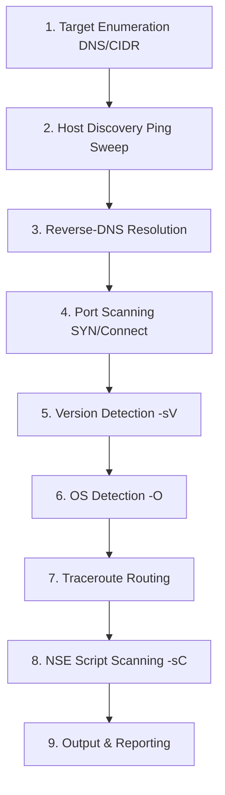
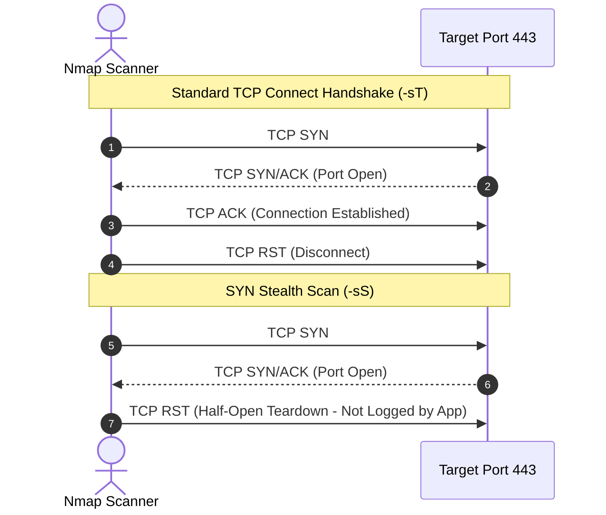

# Nmap Practical Auditing & Network Reconnaissance Masterclass

> [!IMPORTANT]
> **Production Security Engineering Lab | Tier 1 Core Audit Track**
> **Target Audience:** Cloud Security Engineers, Penetration Testers, DevSecOps Architects
> **Key Protocols & Standards:** RFC 793 (TCP), RFC 768 (UDP), NIST SP 800-115, CIS Network Controls
> **Authorization Notice:** Only execute network scanning against systems you own or have explicit, documented authorization to test.

---

## 1. Network Reconnaissance & Port Scanning Fundamentals

Network scanning and service enumeration are foundational disciplines in infrastructure security. Security engineers use these techniques to audit perimeter exposure, verify stateful firewall rules, detect shadow services, and confirm that only sanctioned ports are accessible across VPCs.

- **Scanning**: The automated interrogation of network address spaces to discover responsive hosts, open TCP/UDP ports, and active daemon services.
- **Enumeration**: The granular discovery of daemon banners, software build versions, OS kernel footprints, and misconfigurations on responsive endpoints.

---

## 2. Nmap 10-Phase Scanning Architecture

Nmap (Network Mapper) operates across an optimized, multi-phase execution pipeline. Understanding this pipeline allows security engineers to optimize scan speed, control packet rates, and avoid triggering false alarms on intrusion detection systems.

```architecture
architecture-beta
  service nmap(terminal)[Nmap Security Scanner CLI]
  group target(cloud)[Target Enterprise Network]
  service fw(firewall)[Perimeter Stateful Firewall] in target
  service web(server)[Public HTTPS Web Server] in target
  service ssh(lock)[Bastion SSH Server] in target
  service db(database)[Internal Database Server] in target

  nmap:R -- L:fw
  fw:R -- L:web
  fw:B -- T:ssh
  web:R -- L:db
```

### Scan Phases Workflow



### Execution Pipeline Breakdown

1. **Script Pre-scanning**: Executes initialization NSE scripts that run once per session (e.g., broadcast discovery, DHCP queries) prior to host interrogation.
2. **Target Enumeration**: Translates target arguments (hostnames, IP ranges, CIDR subnets like `10.0.0.0/16`) into a structured list of IPv4 and IPv6 target addresses.
3. **Host Discovery (Ping Sweep)**: Sends ARP, ICMP Echo, and TCP/UDP SYN probes to identify live systems and eliminate inactive IP addresses from subsequent compute-heavy phases.
4. **Reverse-DNS Resolution**: Resolves PTR records for discovered live hosts to surface domain names and identify server roles (e.g., `bastion-01.corp.internal`).
5. **Port Scanning**: Transmits targeted Layer 4 probes (TCP SYN, ACK, FIN, or UDP) to categorize destination ports as `open`, `closed`, or `filtered`.
6. **Version Detection (`-sV`)**: Interrogates open ports with protocol-specific probes and matches daemon responses against thousands of known service signatures.
7. **OS Detection (`-O`)**: Examines TCP ISN (Initial Sequence Number) predictability, TCP options, and IP header behavior to fingerprint the target OS kernel.
8. **Traceroute**: Uses multi-packet probe techniques to trace IP routing hops and network latency from scanner to target.
9. **Script Scanning (`-sC`)**: Executes Nmap Scripting Engine (NSE) automation against identified services for vulnerability auditing, TLS cipher checks, and configuration extraction.
10. **Output & Reporting**: Formats collected scan intelligence into human-readable text, interactive XML, or grepable output formats.

---

## 3. TCP Three-Way Handshake & Scan Mechanics

TCP port scanning leverages the deterministic mechanics of the RFC 793 connection establishment sequence:



### The RFC 793 Connection Mechanics
1. **TCP Port Basics**: Layer 4 ports identify specific listening processes. IP addresses route packets to the host, while port numbers (0–65535) direct datagrams to the correct socket.
2. **The 3-Way Handshake**:
   - Client sends **SYN** (Synchronize sequence numbers).
   - Server responds with **SYN/ACK** (Synchronize and Acknowledge) if listening, or **RST** (Reset) if closed.
   - Client returns **ACK** to establish the stateful connection.

---

## 4. Full Connect (`-sT`) vs. SYN Stealth (`-sS`) Audit Comparison

Nmap provides two primary TCP scanning methods with distinct trade-offs:

| Feature | TCP Connect Scan (`-sT`) | SYN Stealth Scan (`-sS`) |
|---|---|---|
| **Handshake State** | Full 3-Way Handshake completed (`SYN` → `SYN/ACK` → `ACK` → `RST`) | Half-open teardown (`SYN` → `SYN/ACK` → immediate `RST`) |
| **Privileges Required** | Standard user (Uses Berkeley socket `connect()` system call) | Root / Administrator (`CAP_NET_RAW` raw packet creation) |
| **Application Logging** | High (Completed connections trigger application logging) | Low (Half-open connections rarely reach application loggers) |
| **Network Overhead** | Higher (3-4 packets per port) | Lower (2 packets per responsive port) |
| **Scan Speed** | Slower (Kernel socket allocation overhead) | Rapid (Direct raw packet assembly) |
| **Firewall Visibility** | Standard traffic profile | Detected by modern stateful firewalls & IDS/IPS engines |

> [!TIP]
> Use `-sS` when you have administrator privileges and require high throughput. Fall back to `-sT` when running inside restricted container environments where raw socket creation is denied by seccomp profiles.

---

## 5. Setting Up a Dockerized Vulnerable Security Lab

To practice scanning techniques safely without risking production infrastructure, deploy this disposable 4-tier containerized environment:

```yaml
version: '3.8'

services:
  web-server:
    image: nginx:alpine
    container_name: lab-web-server
    ports:
      - "80:80"
    networks:
      nmap-network:
        ipv4_address: 172.28.0.2

  ftp-server:
    image: delfer/alpine-ftp-server
    container_name: lab-ftp-server
    environment:
      - USERS=user:password:1000:1000
    ports:
      - "21:21"
      - "21000-21010:21000-21010"
    networks:
      nmap-network:
        ipv4_address: 172.28.0.3

  ssh-server:
    image: linuxserver/openssh-server
    container_name: lab-ssh-server
    environment:
      - PUID=1000
      - PGID=1000
      - TZ=UTC
      - PASSWORD_ACCESS=true
      - USER_PASSWORD=password
      - USER_NAME=audituser
    ports:
      - "2222:2222"
    networks:
      nmap-network:
        ipv4_address: 172.28.0.4

  mysql-server:
    image: mariadb:latest
    container_name: lab-db-server
    environment:
      - MYSQL_ROOT_PASSWORD=auditing-secret-pass
    ports:
      - "3306:3306"
    networks:
      nmap-network:
        ipv4_address: 172.28.0.5

networks:
  nmap-network:
    driver: bridge
    ipam:
      config:
        - subnet: 172.28.0.0/16
```

### Launching the Isolated Lab

```bash
# 1. Start the containers in the background
docker-compose -f docker-compose.lab.yml up -d

# 2. Verify all 4 containers are healthy and running
docker ps --format "table {{.Names}}\t{{.Status}}\t{{.Ports}}"
```

---

## 6. Hands-On Scanning & Port State Classification

### The Three Core Port States

Nmap categorizes scanned destination ports into clear state classifications:

- **Open**: An active service is accepting incoming connections on this port.
- **Closed**: The probe packet reached the host, but the OS returned a TCP RST packet indicating no daemon is listening.
- **Filtered**: Probes were dropped or ICMP unreachable errors were received, indicating stateful packet inspection or a firewall block.

### Executing Target Scans Against Lab Services

```bash
# Audit specific container service ports
nmap -sT -Pn -p 80 172.28.0.2          # Nginx Web Server
nmap -sT -Pn -p 21,21000-21010 172.28.0.3  # FTP Server
nmap -sT -Pn -p 2222 172.28.0.4        # SSH Server
nmap -sT -Pn -p 3306 172.28.0.5        # MariaDB Database
```

### Consolidated Multi-Port Audit

```bash
nmap -sT -Pn -p 21,80,2222,3306,21000-21010 127.0.0.1
```

```text
Starting Nmap 7.95 ( https://nmap.org ) at 2026-10-31 04:00 UTC
Nmap scan report for localhost (127.0.0.1)
Host is up (0.00032s latency).

PORT      STATE SERVICE
21/tcp    open  ftp
80/tcp    open  http
2222/tcp  open  ssh
3306/tcp  open  mysql
21000/tcp open  irtrans
21001/tcp open  unknown
21002/tcp open  unknown
21010/tcp open  notezilla-lan

Nmap done: 1 IP address (1 host up) scanned in 0.03 seconds
```

### Executing SYN Stealth Scans (`-sS`)

```bash
# SYN scan with port specification (requires sudo / raw socket capabilities)
sudo nmap -sS -Pn -p 80,443 127.0.0.1
```

```text
Starting Nmap 7.95 ( https://nmap.org ) at 2026-10-31 04:04 UTC
Nmap scan report for localhost (127.0.0.1)
Host is up (0.000089s latency).

PORT    STATE  SERVICE
80/tcp  open   http
443/tcp closed https

Nmap done: 1 IP address (1 host up) scanned in 0.02 seconds
```

---

## 7. Advanced UDP Scanning & Firewall Evasion Techniques

### Auditing UDP Services (`-sU`)

While most web applications run over TCP, critical infrastructure services rely on UDP (DNS port 53, SNMP ports 161/162, DHCP ports 67/68, NTP port 123, and WireGuard VPN port 51820).

> [!WARNING]
> UDP scanning is inherently slower than TCP. When a UDP packet is sent to a closed port, the OS sends an ICMP Port Unreachable packet. Operating systems rate-limit these ICMP error responses (e.g., Linux limits them to 1 per second), causing full-range UDP sweeps to take significant time.

```bash
# Target common UDP infrastructure services
sudo nmap -sU -p 53,123,161,51820 127.0.0.1
```

### Packet Fragmentation & MTU Manipulation (`-f`, `--mtu`)

To audit whether perimeter firewalls and intrusion prevention systems reassemble fragmented IP datagrams, security engineers test packet splitting:

```bash
# Split probe packets into 8-byte fragments
sudo nmap -f 127.0.0.1

# Enforce custom MTU boundary (must be multiple of 8)
sudo nmap --mtu 24 127.0.0.1
```

### Decoy Scanning (`-D`)

To mask the origin of a scan in an authorized audit, decoy addresses can be interleaved with genuine probe packets:

```bash
# Send probes interleaved with decoy IPs (ME designates scanner position)
sudo nmap -D 192.168.1.100,192.168.1.101,ME,192.168.1.102 127.0.0.1
```

---

## 8. Host Discovery & Service Version Fingerprinting

### Ping Sweep & Host Discovery Options

```bash
# Host discovery only - disable port scanning (-sn)
sudo nmap -sn 172.28.0.0/24

# Disable host discovery - treat all target hosts as live (-Pn)
nmap -Pn -p 80,443 172.28.0.2
```

### OS Kernel & Service Version Detection (`-sV`, `-O`)

```bash
# Service version detection with aggressive banner probing
sudo nmap -sV --version-intensity 7 -p 21,80,2222,3306 127.0.0.1
```

```text
PORT     STATE SERVICE VERSION
21/tcp   open  ftp     vsftpd 2.0.8 or later
80/tcp   open  http    nginx 1.27.4
2222/tcp open  ssh     OpenSSH 9.9 (protocol 2.0)
3306/tcp open  mysql   MariaDB 11.7.2
```

```bash
# Operating System fingerprinting
sudo nmap -O --osscan-guess 127.0.0.1
```

---

## 9. Performance Tuning & Timing Templates (`-T0` to `-T5`)

Nmap includes 6 predefined timing templates to modulate probe intervals, timeouts, and parallel socket limits:

| Template | Name | Use Case | Behavior & Timing |
|---|---|---|---|
| `-T0` | **Paranoid** | IDS/IPS evasion | Probes are serialized with 5-minute pauses between packets |
| `-T1` | **Sneaky** | Sensitive networks | Probes paused for 15 seconds |
| `-T2` | **Polite** | Bandwidth conservation | Slows scan down to consume minimal bandwidth |
| `-T3` | **Normal** | Default setting | Standard dynamic timing based on measured network latency |
| `-T4` | **Aggressive** | Modern cloud VPCs | Shorter timeouts, faster parallel sweeps; recommended for reliable networks |
| `-T5` | **Insane** | High-speed local networks | Extremely aggressive timeouts; risks dropping packets on congested links |

```bash
# Recommended production auditing command: fast, thorough, and structured
sudo nmap -sS -sV -O -T4 --top-ports 100 -oA audit-report-$(date +%F) 172.28.0.0/24
```

---

## 10. Enterprise Detection Rules & Defense Recommendations

To protect production cloud workloads from unauthorized reconnaissance, implement deterministic firewall rules and network intrusion detection signatures:

### Suricata / Snort IDS Detection Rule

```text
# Detect high-volume TCP SYN scanning across common ports
alert tcp any any -> $HOME_NET any (msg:"SECURITY-CORNER: Rapid TCP SYN Port Scan Detected"; \
    flags:S; threshold:type threshold, track by_src, count 30, seconds 5; \
    classtype:attempted-recon; sid:1000001; rev:1;)
```

### Cloud Security Architecture Best Practices
1. **Default-Deny Security Groups**: Never expose database (`3306`), SSH (`22`), or FTP (`21`) directly to `0.0.0.0/0`.
2. **Private Subnets & Bastion Gateways**: Place all application workloads and data stores in isolated private VPC subnets with NAT gateways for egress.
3. **AWS GuardDuty / Azure Defender**: Enable continuous VPC flow-log analysis to automatically detect reconnaissance scans and unauthorized probing.
