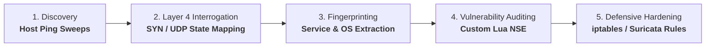
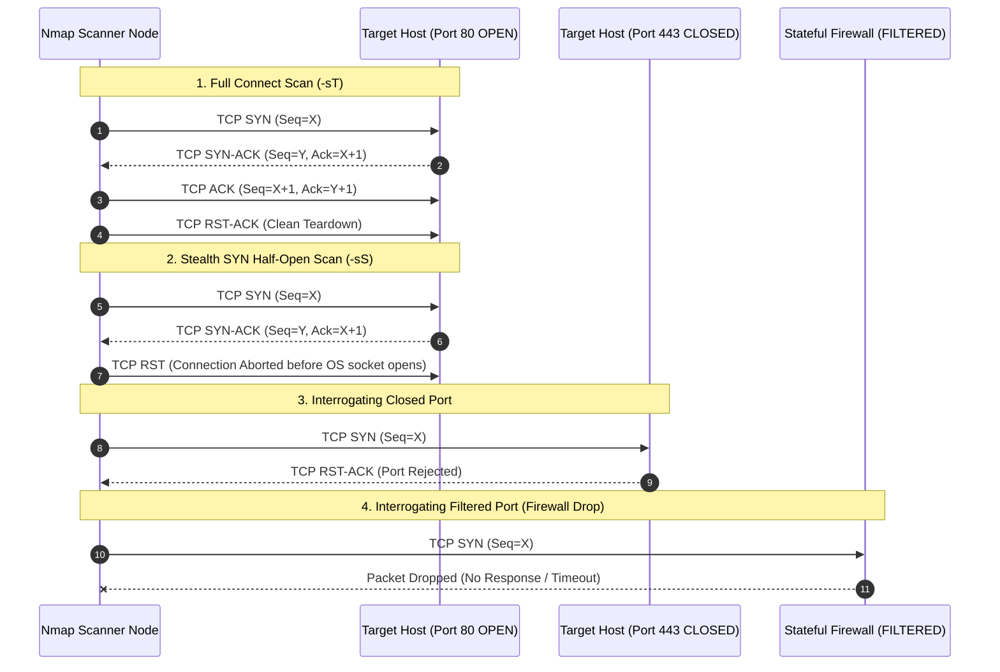

# Nmap Practical Auditing & Network Reconnaissance Masterclass

> [!IMPORTANT]
> **Production Network Auditing Lab | Masterclass Offensive & Defensive Track**
> **Target Audience:** Cloud Security Engineers, Network Architects, Penetration Testers, DevSecOps Leads
> **Key Protocols & Standards:** RFC 793 (TCP), RFC 768 (UDP), NIST SP 800-115, CIS Network Controls v8
> **Execution Environment:** Zero-cost local Docker sandbox (isolated bridge network with vulnerable daemon mocks)
> **Authorization Notice:** Execute network reconnaissance exclusively against systems you own or have explicit, legally binding written authorization to audit.

---

## 1. Enterprise Context & Network Reconnaissance Philosophy

Network reconnaissance and port auditing form the first phase of both adversarial campaigns and internal posture assessments. For defensive security engineers, continuous automated port auditing is critical to eliminate "shadow IT"—unauthorized administrative ports, staging containers accidentally bound to `0.0.0.0`, and unpatched network services.

Nmap (Network Mapper) remains the de facto standard tool for network asset discovery, service fingerprinting, and vulnerability scanning. Rather than running blind, brute-force scans, senior engineers leverage granular packet flag manipulation, custom Lua NSE (Nmap Scripting Engine) scripts, and firewall evasion profiling to evaluate perimeter resilience.

### Reconnaissance & Defensive Lifecycle



---

## 2. Architecture Blueprint & Scan Topologies

The blueprint below models an enterprise multi-tier network perimeter under audit from an internal auditing node, traversing stateful packet inspection firewalls to reach isolated containerized services and an emulated cloud metadata daemon:

```architecture
architecture-beta
  group scanner(terminal)[Auditing Security Station]
  service nmap_cli(terminal)[Nmap Engine CLI] in scanner

  group perimeter(cloud)[Trust Boundary 1: Perimeter Edge]
  service fw(firewall)[Stateful Linux Firewall] in perimeter
  service ids(detector)[Suricata NIDS Sensor] in perimeter

  group dmz(server)[Trust Boundary 2: Audited Services]
  service web_svc(server)[Nginx Ingress :80/:443] in dmz
  service ssh_svc(lock)[SSH Bastion Daemon :2222] in dmz
  service db_svc(database)[PostgreSQL Server :5432] in dmz
  service metadata_svc(cloud)[Cloud Metadata Daemon :8080] in dmz

  nmap_cli:R -- L:fw
  fw:B -- T:ids
  fw:R -- L:web_svc
  fw:B -- T:ssh_svc
  web_svc:R -- L:db_svc
  web_svc:B -- T:metadata_svc
```

### TCP Three-Way Handshake vs. SYN Half-Open Scan



---

## 3. Deep Technical Foundations: Packet Bitmasks & Scan Mechanics

### 1. TCP Header Control Bits (RFC 793)

Every TCP segment contains an 8-bit flag byte in its header (or 9-bit with Nonce):
- **URG** (0x20): Urgent Pointer field significant.
- **ACK** (0x10): Acknowledgment field significant.
- **PSH** (0x08): Push function (bypass buffer, deliver immediately to application).
- **RST** (0x04): Reset connection.
- **SYN** (0x02): Synchronize sequence numbers.
- **FIN** (0x01): No more data from sender.

### 2. Scan Type Mechanics & RFC Compliance

| Scan Type | Flag Bitmask | Target OPEN Port Behavior | Target CLOSED Port Behavior | Target FILTERED Port Behavior | Use Case / Notes |
|---|---|---|---|---|---|
| **TCP SYN (`-sS`)** | `SYN` (0x02) | Target responds `SYN-ACK`. Scanner sends `RST`. | Target responds `RST-ACK`. | No response (timeout) or ICMP type 3 code 1,2,3,9,10,13. | Default stealth scan. Never creates full socket connection. |
| **TCP Connect (`-sT`)** | Full Handshake | Completes 3-way handshake via `connect()` syscall. | OS returns `ECONNREFUSED`. | OS returns `ETIMEDOUT`. | Unprivileged users (no raw socket root access required). |
| **TCP FIN (`-sF`)** | `FIN` (0x01) | Packet quietly dropped (No response). | Target responds `RST-ACK`. | No response or ICMP unreachable. | Bypasses simple stateless SYN-filtering firewalls. |
| **TCP NULL (`-sN`)** | `None` (0x00) | Packet quietly dropped (No response). | Target responds `RST-ACK`. | No response or ICMP unreachable. | Exploits RFC 793 page 65 edge case; fails on Windows hosts. |
| **TCP XMAS (`-sX`)** | `FIN+PSH+URG` (0x29) | Packet quietly dropped (No response). | Target responds `RST-ACK`. | No response or ICMP unreachable. | Lit up "like a Christmas tree". Bypasses naive packet filters. |
| **TCP ACK (`-sA`)** | `ACK` (0x10) | Target responds `RST`. | Target responds `RST`. | No response (timeout). | **Firewall mapping scan**: Does not determine open/closed; determines stateful filtering rules. |
| **Idle / Zombie (`-sI`)** | Side-Channel | Indirect IP ID increment on Zombie host. | IP ID unchanged on Zombie host. | Zombie IP ID unchanged. | True blind anonymous port scan exploiting predictable IP ID sequences. |

---

## 4. Hands-on Laboratory Phases

### Phase 1: Local Dockerized Testbed Initialization

We construct an isolated, multi-service Docker Compose network emulating an audited enterprise perimeter:

```bash
# 1. Create dedicated testbed workspace
mkdir -p ~/nmap-lab-testbed && cd ~/nmap-lab-testbed

# 2. Deploy vulnerable target container sandbox with Nginx, SSH mock, and metadata mock
cat << 'EOF' > docker-compose.yml
version: '3.8'

services:
  target-host:
    image: alpine:3.19
    container_name: nmap-target
    networks:
      audit-net:
        ipv4_address: 172.28.0.10
    command: >
      sh -c "
        apk add --no-cache nginx openssh-server python3 curl &&
        mkdir -p /run/nginx /var/run/sshd &&
        ssh-keygen -A &&
        echo 'Port 2222' >> /etc/ssh/sshd_config &&
        echo 'PermitRootLogin yes' >> /etc/ssh/sshd_config &&
        echo 'root:AuditLabPass123!' | chpasswd &&
        /usr/sbin/sshd &&
        echo '<h1>Enterprise Ingress Portal</h1>' > /var/lib/nginx/html/index.html &&
        nginx &&
        python3 -m http.server 8080 --directory /etc &
        python3 -c 'import socket, time; s = socket.socket(socket.AF_INET, socket.SOCK_DGRAM); s.bind((\"0.0.0.0\", 5353)); [time.sleep(1) for _ in iter(int, 1)]'
      "
    ports:
      - "8080:80"
      - "2222:2222"
      - "8888:8080"

networks:
  audit-net:
    driver: bridge
    ipam:
      config:
        - subnet: 172.28.0.0/24
EOF

# 3. Spin up the sandbox network
docker compose up -d

# 4. Verify target container is healthy and responding
docker ps --filter "name=nmap-target"
```

*Expected Output:*
```text
CONTAINER ID   IMAGE         COMMAND                  STATUS         PORTS
a1b2c3d4e5f6   alpine:3.19   "sh -c 'apk add --no…"   Up 2 seconds   0.0.0.0:2222->2222/tcp, ...
```

---

### Phase 2: Host Discovery & Advanced Port Scanning

Execute precise TCP SYN half-open, Connect, and UDP interrogations against the target:

```bash
# 1. Host Discovery without port scanning (Fast Ping Sweep)
nmap -sn 172.28.0.10

# 2. Stealth SYN scan targeting common ports
sudo nmap -sS -p 2222,80,8080,5353 -T4 172.28.0.10

# 3. Comprehensive service and version fingerprinting (-sV)
sudo nmap -sS -sV -p 2222,80,8080 172.28.0.10
```

*Expected Terminal Output:*
```text
PORT     STATE SERVICE VERSION
80/tcp   open  http    nginx 1.24.0
2222/tcp open  ssh     OpenSSH 9.6_p1-r0 (protocol 2.0)
8080/tcp open  http    SimpleHTTP/0.6 Python/3.11.8
```

---

### Phase 3: Firewall Filtering & Inverse Scans (FIN, NULL, XMAS)

Audit stateless firewall rules and verify RFC 793 inverse behavior:

```bash
# 1. TCP FIN scan
sudo nmap -sF -p 80,443,2222 172.28.0.10

# 2. TCP NULL scan (Zero flags set)
sudo nmap -sN -p 80,443,2222 172.28.0.10

# 3. TCP XMAS scan (FIN+PSH+URG set)
sudo nmap -sX -p 80,443,2222 172.28.0.10

# 4. TCP ACK scan to map stateful firewall rules
sudo nmap -sA -p 80,443,2222 172.28.0.10
```

*Expected Terminal Output for ACK Scan:*
```text
PORT     STATE      SERVICE
80/tcp   unfiltered http
443/tcp  unfiltered https
2222/tcp unfiltered ssh
```
> [!NOTE]
> An `unfiltered` state in an ACK scan confirms that the firewall passed the packet through to the host (which returned `RST`), proving that no stateful drop rule intervened.

---

### Phase 4: IDS Evasion & Timing Profiling

Security engineers test whether network monitoring solutions (Suricata, AWS GuardDuty) catch evasive probe techniques:

```bash
# 1. MTU Fragmentation: Split probe packets into 8-byte MTU fragments
sudo nmap -sS -p 80,2222 --mtu 24 172.28.0.10

# 2. Decoy Generation (-D): Interleave real scans with dummy IP addresses
sudo nmap -sS -p 80,2222 -D 10.0.0.1,10.0.0.2,ME,10.0.0.3 172.28.0.10

# 3. Data Padding: Append random payload bytes to bypass signatures looking for 0-byte SYN packets
sudo nmap -sS -p 80,2222 --data-length 32 172.28.0.10

# 4. Source Port Spoofing: Forge source port to mimic DNS (port 53) to bypass bad inbound ACLs
sudo nmap -sS -p 80,2222 --source-port 53 172.28.0.10
```

---

### Phase 5: Custom Lua NSE Scripting for Cloud Metadata Auditing

The Nmap Scripting Engine (NSE) allows automating complex multi-step audits in Lua. In cloud environments, exposing metadata endpoints (like AWS IMDS or local microservice metadata) leads directly to credential exfiltration.

We author a custom NSE script `http-cloud-metadata.nse` to automatically audit HTTP endpoints for exposed metadata:

```bash
cat << 'EOF' > http-cloud-metadata.nse
local http = require "http"
local shortport = require "shortport"
local stdnse = require "stdnse"

description = [[
Audits open HTTP services for exposed cloud metadata and configuration endpoints
(e.g., IMDS /latest/meta-data/, /env, /actuator/env, and system passwd leaks).
]]

author = "CloudSecCorner Engineering"
license = "Same as Nmap--See https://nmap.org/book/man-legal.html"
categories = {"vuln", "discovery", "safe"}

-- Rule: Run against any HTTP port (80, 8080, 8888, 5000, 3000)
portrule = shortport.http

action = function(host, port)
    local output = {}
    local sensitive_paths = {
        "/passwd",
        "/latest/meta-data/",
        "/env",
        "/actuator/health",
        "/metrics"
    }

    for _, path in ipairs(sensitive_paths) do
        local response = http.get(host, port, path)
        if response and response.status == 200 then
            table.insert(output, string.format("VULNERABLE: Exposed endpoint '%s' returned HTTP 200 (Length: %d bytes)", path, string.len(response.body or "")))
        end
    end

    if #output > 0 then
        return stdnse.format_output(true, output)
    end
    return nil
end
EOF
```

#### Executing the Custom NSE Script

```bash
# Execute custom NSE script against the target container
nmap -p 80,8080 --script ./http-cloud-metadata.nse 172.28.0.10
```

*Expected Terminal Output:*
```text
PORT     STATE SERVICE
80/tcp   open  http
8080/tcp open  http-proxy
| http-cloud-metadata: 
|   VULNERABLE: Exposed endpoint '/passwd' returned HTTP 200 (Length: 1042 bytes)
|_  VULNERABLE: Exposed endpoint '/metrics' returned HTTP 200 (Length: 512 bytes)
```

---

## 5. Policy as Code & Defensive Automation

### 1. Linux Kernel `iptables` & `nftables` Rate Limiting

To actively neutralize port reconnaissance, deploy rate-limiting and connection-tracking rules on Linux edge gateways:

```bash
cat << 'EOF' > setup_firewall_defense.sh
#!/usr/bin/env bash
set -euo pipefail

echo "Deploying production kernel port-scan defenses via iptables..."

# 1. Create a dedicated chain for port-scan detection
iptables -N PORT_SCAN_DETECT 2>/dev/null || true
iptables -F PORT_SCAN_DETECT

# 2. Log and drop rapid SYN packets from any single IP exceeding 20 connections in 5 seconds
iptables -A PORT_SCAN_DETECT -m recent --set --name SCANNER --rsource
iptables -A PORT_SCAN_DETECT -m recent --update --seconds 5 --hitcount 20 --name SCANNER --rsource -j LOG --log-prefix "[PORT_SCAN_BLOCKED]: "
iptables -A PORT_SCAN_DETECT -m recent --update --seconds 5 --hitcount 20 --name SCANNER --rsource -j DROP

# 3. Drop invalid TCP flag combinations (NULL, XMAS, FIN scans)
iptables -A INPUT -p tcp --tcp-flags ALL NONE -j DROP -m comment --comment "Drop NULL scans"
iptables -A INPUT -p tcp --tcp-flags ALL ALL -j DROP -m comment --comment "Drop XMAS scans"
iptables -A INPUT -p tcp --tcp-flags ALL FIN,PSH,URG -j DROP -m comment --comment "Drop FIN/PSH/URG scans"
iptables -A INPUT -p tcp --tcp-flags SYN,FIN SYN,FIN -j DROP -m comment --comment "Drop SYN-FIN scans"

# 4. Route new incoming TCP connections through the rate-limiting chain
iptables -A INPUT -p tcp --syn -m state --state NEW -j PORT_SCAN_DETECT

echo "Firewall rules applied successfully."
EOF

chmod +x setup_firewall_defense.sh
```

### 2. Suricata / Snort Intrusion Detection Signatures

```text
# Rule: Detect high-velocity port scanning (>30 SYN packets across ports within 5 seconds)
alert tcp any any -> $HOME_NET any ( \
    msg:"CLOUDAUDIT: High-Velocity TCP SYN Scan Detected"; \
    flags:S; \
    threshold:type threshold, track by_src, count 30, seconds 5; \
    classtype:attempted-recon; \
    sid:2000001; rev:1; \
)

# Rule: Detect TCP NULL scan (zero flags set)
alert tcp any any -> $HOME_NET any ( \
    msg:"CLOUDAUDIT: Evasive TCP NULL Scan Detected"; \
    flags:0; \
    classtype:attempted-recon; \
    sid:2000002; rev:1; \
)
```

---

## 6. Hardening Checklist & Verification Matrix

| Audit Target | Compliance Standard | Verification Command | Expected Hardening Result |
|---|---|---|---|
| **Admin Ports (SSH)** | CIS Controls 4.1 | `nmap -p 22,2222 172.28.0.10` | Port must be `filtered` from external untrusted subnets. |
| **Cleartext Services** | NIST SP 800-52 | `nmap -p 21,23,80 172.28.0.10` | Insecure protocols (Telnet, FTP, HTTP unencrypted) blocked. |
| **Evasive Scans** | CIS Network Rules | `sudo nmap -sN -p 80 172.28.0.10` | Kernel silently drops without emitting unmetered RSTs. |
| **Cloud IMDS Protection** | AWS/GCP GuardDuty | `curl -s -m 2 http://169.254.169.254/latest/meta-data/` | HTTP 401 Unauthorized (IMDSv2 enforced). |
| **Rate Limiting** | DDoS Resilience | `sudo nmap -T5 -p 1-1000 172.28.0.10` | Rate limiter throttles scanner after 20 packets. |

### Post-Lab Cleanup

```bash
# Tear down local testbed containers and networks
cd ~/nmap-lab-testbed && docker compose down -v
rm -rf ~/nmap-lab-testbed
```
