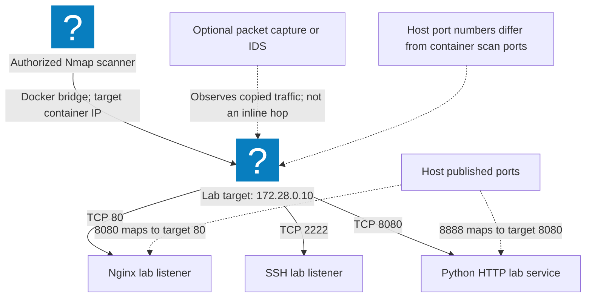
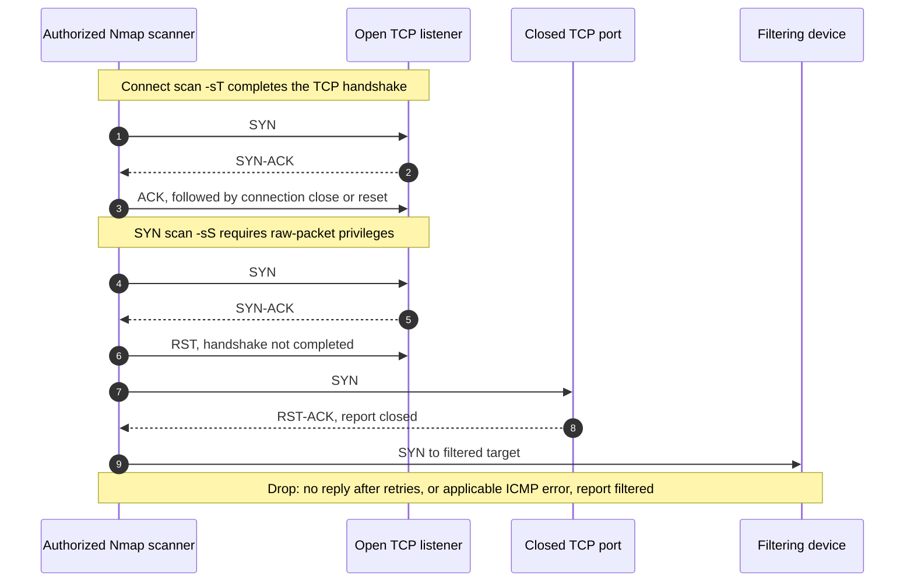

# Nmap Practical Auditing: Measure Exposure and Verify the Fix

Reviewed: 2026-11-06 · Foundational · 30–45 minutes

## Why this lab changed

Modern exposure management connects inventory, reachable services, vulnerability applicability, and remediation evidence. An open port or guessed service version is one observation, not proof of a CVE. This lab replaces broad scan recipes with a bounded audit of a server created by the exercise itself.

Read the official [Nmap port-state guide](https://nmap.org/book/man-port-scanning-basics.html), [version-detection guidance](https://nmap.org/book/man-version-detection.html), and [NSE documentation](https://nmap.org/book/man-nse.html) when choosing probes. Script selection requires review; broad script categories can include disruptive behavior.

## Prerequisites and scope

Python 3.10 or newer and Nmap on `PATH`. No root privileges are needed for the TCP connect scan. The [complete exercise](/labs/examples/exposure-audit.py) binds a temporary HTTP listener to `127.0.0.1`, scans that one port, stops the listener, and rescans it.

The scanner never accepts an external target. If Nmap is absent, the actual scan test is explicitly skipped; the XML parser test alone does not complete the practical lab.

## Audit workflow

```mermaid
flowchart LR
      scope[Confirm approved hosts and scan window] --> discovery[Host discovery with recorded scope]
      discovery --> ports[Map TCP and UDP states separately]
      ports --> versions[Probe service versions with bounded retries]
      versions --> validate[Validate findings; select relevant NSE scripts]
      validate --> harden[Restrict exposed listeners and firewall rules]
      harden --> retest[Repeat scan and compare saved results]
```



## Exercise 1: run the controlled before-and-after audit

```bash
nmap --version
python3 public/labs/examples/exposure-audit.py
```

For a downloaded copy, inspect the file and run `python3 exposure-audit.py`.

Expect two passing tests and no skips when Nmap is installed. The first checks that `open` and `filtered` XML states are not conflated. The second runs real `-sT -Pn -n` scans with one retry, a 20-second host timeout, and a single ephemeral target port. The first scan must observe the listener; the second must no longer report it open.

## Exercise 2: understand host and container port mappings



This diagram shows an optional Docker test topology, not the local Python target. A container's port 80 and a host's published port 8080 are different scan targets. Record the network namespace, target address, interface, and port mapping before comparing findings from different locations.

## Exercise 3: interpret the result precisely



| Observation | Defensible conclusion |
| --- | --- |
| TCP port open | A listener accepted the probe from this vantage point |
| Port closed after stopping service | The local listener is no longer reachable on that port |
| Port filtered | Probe behavior suggests filtering or an applicable network error |
| Service/version guess | Candidate identity requiring confirmation |

Do not label a connect scan invisible. Do not equate the absence of a response with a patched service. A firewall change may reduce exposure while the vulnerable software still requires remediation.

## Expected evidence and trend extension

Save the target scope, Nmap version, port, timestamp, before state, after state, and remediation owner. The script deletes its temporary XML files; for a retained report, modify your own copy to write into a dedicated evidence directory and redact addresses before sharing.

For a real asset, correlate findings with vendor advisories, installed package versions, the [CISA KEV catalog](https://www.cisa.gov/known-exploited-vulnerabilities-catalog), and [FIRST EPSS](https://www.first.org/epss/). KEV records known exploitation; EPSS estimates exploitation probability over the next 30 days. Neither identifies whether your specific asset is affected or exposed.

## Troubleshooting and cleanup

If the listener test is skipped, install Nmap and rerun it. If local sockets are restricted, use an environment that permits loopback access. The suite stops its HTTP server and removes its temporary reports. It performs no scans of a cloud account, shared subnet, or public service. Continue with [exposure-prioritization field notes](/blog/Exposure-Prioritization-2026).
