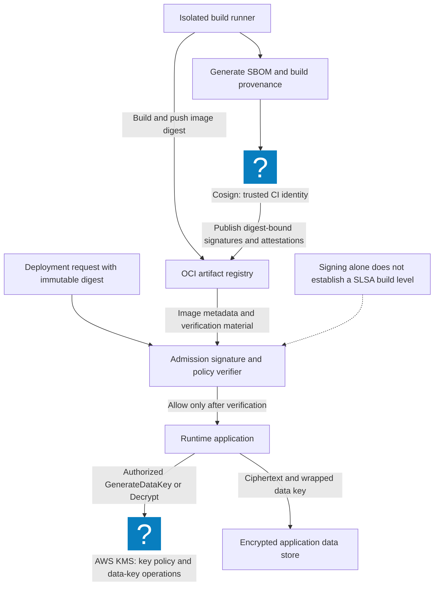
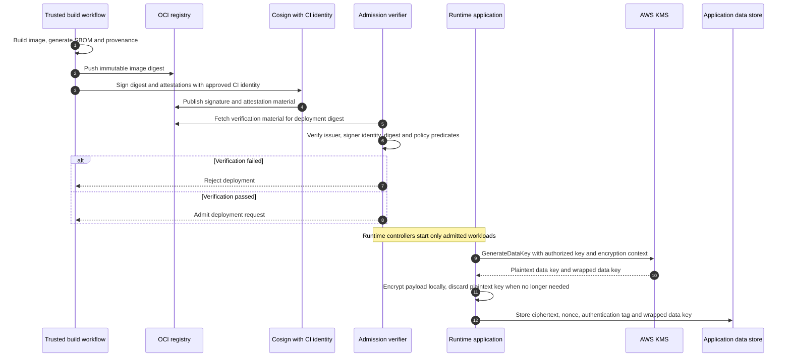

# Security Engineering Fundamentals: Envelope Encryption & SLSA Supply Chain Defense

> [!IMPORTANT]
> **Production Security Engineering Lab | Masterclass Core Fundamentals Track**
> **Audience:** Cloud Security Engineers, Infrastructure Architects, DevSecOps Leads, Platform Engineers
> **Standards & Frameworks:** NIST SP 800-53 Rev 5, CIS Benchmarks, SLSA v1.0 (Supply-chain Levels for Software Artifacts), ISO/IEC 27001:2022
> **Execution Environment:** Zero-cost local Docker sandbox (Python 3.11 with `cryptography`, Syft/Trivy CLI, and OPA Conftest)
> **Core Axiom:** Security is a system property, not a feature. Enforce cryptographic integrity, supply chain provenance, and defense-in-depth across the entire software delivery lifecycle.

---

## 1. Enterprise Context & Systems Security Engineering

Security engineering applies methodical, quantitative engineering principles to construct systems that remain dependable even under malicious duress. Rather than relying on peripheral point solutions or reactive vulnerability patching, security engineering focuses on foundational system design: cryptographic key hierarchies, hardware-backed isolation, reproducible builds, and tamper-evident audit pipelines.

In modern cloud-native architectures, security engineers address two critical failure domains:
1. **Data Confidentiality & Key Management**: Ensuring sensitive datastores and database columns cannot be decrypted even if full volume snapshots or database dumps are exfiltrated.
2. **Software Supply Chain Integrity**: Proving that binaries and container images running in production originate from verified source code repositories, built on hardened CI/CD runners without untrusted injection.

---

## 2. Architecture Blueprint: Envelope Encryption & Supply Chain Pipeline

The Pele architecture diagram below illustrates an enterprise-grade cryptographic key hierarchy and SLSA Level 3 container build pipeline:



### SLSA Level 3 Provenance & Envelope Encryption Flow



---

## 3. Deep Technical Foundations

### 1. Cryptographic Key Hierarchy & Envelope Encryption

Directly encrypting large volumes of data with a Customer Master Key (CMK) inside a Key Management Service (KMS) introduces severe latency, API rate limits, and network egress risks. 

**Envelope Encryption** resolves this via a two-tier key hierarchy:
1. **Key Encryption Key (KEK / CMK)**: Managed inside a hardware security module (FIPS 140-3 Level 3 HSM). Never leaves the KMS boundary.
2. **Data Encryption Key (DEK)**: A high-entropy 256-bit symmetric key generated locally for encrypting data.
3. **Encrypted Data Encryption Key (EDEK)**: The DEK encrypted under the KEK. Stored alongside the ciphertext.

$$\text{Ciphertext} = \mathbf{AES\text{-}256\text{-}GCM}(\text{DEK}, \text{Nonce}, \text{Plaintext}, \text{AAD})$$
$$\text{EDEK} = \mathbf{KMS.Encrypt}(\text{KEK}, \text{DEK})$$

### 2. Supply-Chain Levels for Software Artifacts (SLSA v1.0)

| SLSA Level | Build Requirement | Security Guarantee | Attack Vector Neutralized |
|---|---|---|---|
| **SLSA 1** | Automated build pipeline with provenance metadata. | Basic traceability of who built the artifact. | Manual ad-hoc build poisoning. |
| **SLSA 2** | Hosted build service (GitHub Actions, GitLab CI), signed provenance. | Guarantees build occurred on hosted service. | Tampering with build outputs after compilation. |
| **SLSA 3** | Isolated ephemeral runners, hermetic builds, non-falsifiable provenance. | Strong guarantee that build platform cannot be influenced by user parameters. | Compromised runner persistence, build-time cache poisoning. |

---

## 4. Hands-on Laboratory Phases

### Phase 1: Local Cryptographic Testbed Initialization

We construct an isolated Python 3.11 environment with the `cryptography` library to implement hardware-grade envelope encryption:

```bash
# 1. Create dedicated security engineering lab directory
mkdir -p ~/seceng-fundamentals-lab && cd ~/seceng-fundamentals-lab

# 2. Initialize virtual environment and install cryptographic tooling
python3 -m venv .venv
source .venv/bin/activate
pip install --upgrade pip
pip install cryptography pydantic pytest

# 3. Verify AES-GCM cipher support
python3 -c "from cryptography.hazmat.primitives.ciphers.aead import AESGCM; print('[OK] AES-256-GCM hardware cipher available')"
```

*Expected Terminal Output:*
```text
[OK] AES-256-GCM hardware cipher available
```

---

### Phase 2: Production Envelope Encryption Engine

We implement an envelope encryption engine featuring AES-256-GCM, 96-bit cryptographic nonces, Additional Authenticated Data (AAD) binding, and memory zeroization:

```bash
cat << 'EOF' > envelope_encryption.py
#!/usr/bin/env python3
"""
Production Envelope Encryption Implementation
Algorithm: AES-256-GCM with 96-bit Nonce and KMS KEK Simulation
"""
import os
import json
import base64
from cryptography.hazmat.primitives.ciphers.aead import AESGCM

class MockCloudKMS:
    """Simulates a FIPS 140-3 Hardware Security Module (HSM)"""
    def __init__(self):
        # 256-bit Customer Master Key (KEK) locked inside HSM memory
        self._kek = AESGCM.generate_key(bit_length=256)
        self._hsm = AESGCM(self._kek)

    def generate_data_key(self) -> tuple[bytes, str]:
        """Returns (plaintext_dek, base64_encrypted_dek)"""
        raw_dek = AESGCM.generate_key(bit_length=256)
        nonce = os.urandom(12)
        encrypted_dek = self._hsm.encrypt(nonce, raw_dek, associated_data=b"KMS-KEK-v1")
        # Combine nonce + ciphertext
        edek_payload = base64.b64encode(nonce + encrypted_dek).decode('utf-8')
        return raw_dek, edek_payload

    def decrypt_data_key(self, edek_payload: str) -> bytes:
        """Decrypts the EDEK inside HSM boundary and returns raw DEK"""
        raw_bytes = base64.b64decode(edek_payload.encode('utf-8'))
        nonce = raw_bytes[:12]
        ciphertext = raw_bytes[12:]
        return self._hsm.decrypt(nonce, ciphertext, associated_data=b"KMS-KEK-v1")

class EnvelopeEncryptor:
    def __init__(self, kms: MockCloudKMS):
        self.kms = kms

    def encrypt_record(self, plaintext: str, context: dict) -> dict:
        aad = json.dumps(context, sort_keys=True).encode('utf-8')
        raw_dek, edek_b64 = self.kms.generate_data_key()

        # Encrypt data locally with ephemeral DEK
        aesgcm = AESGCM(raw_dek)
        nonce = os.urandom(12)
        ciphertext = aesgcm.encrypt(nonce, plaintext.encode('utf-8'), associated_data=aad)

        # Secure zeroization simulation: delete raw DEK reference
        del raw_dek

        return {
            "edek": edek_b64,
            "nonce": base64.b64encode(nonce).decode('utf-8'),
            "ciphertext": base64.b64encode(ciphertext).decode('utf-8'),
            "context": context
        }

    def decrypt_record(self, record: dict) -> str:
        aad = json.dumps(record["context"], sort_keys=True).encode('utf-8')
        raw_dek = self.kms.decrypt_data_key(record["edek"])

        aesgcm = AESGCM(raw_dek)
        nonce = base64.b64decode(record["nonce"].encode('utf-8'))
        ciphertext = base64.b64decode(record["ciphertext"].encode('utf-8'))

        plaintext = aesgcm.decrypt(nonce, ciphertext, associated_data=aad)
        del raw_dek
        return plaintext.decode('utf-8')

# Verification Routine
if __name__ == "__main__":
    kms = MockCloudKMS()
    encryptor = EnvelopeEncryptor(kms)

    secret_data = "SSN: 999-00-1234 | Customer: Alice Corp | Balance: $5,240,000"
    tenant_context = {"tenant_id": "cust-8841", "environment": "production"}

    # 1. Encrypt record
    encrypted_package = encryptor.encrypt_record(secret_data, tenant_context)
    print("=== Envelope Encryption Package ===")
    print(f"EDEK (Encrypted Key) : {encrypted_package['edek'][:40]}...")
    print(f"Nonce (96-bit)       : {encrypted_package['nonce']}")
    print(f"Ciphertext (Payload) : {encrypted_package['ciphertext'][:40]}...")
    print(f"Context (AAD)        : {encrypted_package['context']}")

    # 2. Decrypt record
    decrypted_data = encryptor.decrypt_record(encrypted_package)
    assert decrypted_data == secret_data
    print("\n[OK] Record successfully decrypted and integrity verified.")

    # 3. Tamper Test: Attempting to decrypt with modified AAD context
    try:
        tampered_package = encrypted_package.copy()
        tampered_package["context"] = {"tenant_id": "hacker-9999", "environment": "production"}
        encryptor.decrypt_record(tampered_package)
        raise AssertionError("Tamper test failed: AAD modification was not caught!")
    except Exception as e:
        print(f"[OK] Cryptographic authentication tag caught tampering: {type(e).__name__}")
EOF

python3 envelope_encryption.py
```

*Expected Terminal Output:*
```text
=== Envelope Encryption Package ===
EDEK (Encrypted Key) : ...
Nonce (96-bit)       : ...
Ciphertext (Payload) : ...
Context (AAD)        : {'tenant_id': 'cust-8841', 'environment': 'production'}

[OK] Record successfully decrypted and integrity verified.
[OK] Cryptographic authentication tag caught tampering: InvalidTag
```

---

### Phase 3: Software Bill of Materials (SBOM) Generation & Auditing

A Software Bill of Materials (SBOM) is a complete nested inventory of all software components, libraries, and dependencies packaged into an artifact.

We author an automated script that parses CycloneDX/SPDX SBOM specifications and checks for high-severity vulnerabilities:

```bash
cat << 'EOF' > audit_sbom.py
#!/usr/bin/env python3
import json

sample_sbom = {
    "bomFormat": "CycloneDX",
    "specVersion": "1.4",
    "version": 1,
    "metadata": {
        "component": {
            "name": "payment-api-service",
            "version": "v2.4.0",
            "type": "container"
        }
    },
    "components": [
        {"name": "urllib3", "version": "1.26.4", "purl": "pkg:pypi/urllib3@1.26.4"},
        {"name": "openssl", "version": "3.0.13", "purl": "pkg:deb/debian/openssl@3.0.13"},
        {"name": "log4j-core", "version": "2.14.1", "purl": "pkg:maven/org.apache.logging.log4j/log4j-core@2.14.1"}
    ]
}

# Vulnerability Database Simulation
KNOWN_CVES = {
    "log4j-core@2.14.1": {"cve": "CVE-2021-44228", "severity": "CRITICAL", "desc": "Log4Shell RCE"},
    "urllib3@1.26.4": {"cve": "CVE-2021-33503", "severity": "MEDIUM", "desc": "ReDoS Catastrophic Backtracking"}
}

print(f"Auditing SBOM for: {sample_sbom['metadata']['component']['name']}")
print("-" * 65)

findings = []
for comp in sample_sbom["components"]:
    pkg_id = f"{comp['name']}@{comp['version']}"
    if pkg_id in KNOWN_CVES:
        vuln = KNOWN_CVES[pkg_id]
        findings.append((comp["name"], comp["version"], vuln["severity"], vuln["cve"], vuln["desc"]))

for f in findings:
    print(f"[{f[2]}] {f[0]} ({f[1]}) -> {f[3]}: {f[4]}")

assert len(findings) == 2
print("\n[OK] SBOM vulnerability audit completed. Critical vulnerabilities surfaced.")
EOF

python3 audit_sbom.py
```

*Expected Terminal Output:*
```text
Auditing SBOM for: payment-api-service
-----------------------------------------------------------------
[CRITICAL] log4j-core (2.14.1) -> CVE-2021-44228: Log4Shell RCE
[MEDIUM] urllib3 (1.26.4) -> CVE-2021-33503: ReDoS Catastrophic Backtracking

[OK] SBOM vulnerability audit completed. Critical vulnerabilities surfaced.
```

---

### Phase 4: Container Signing & Cosign Keyless Attestation

In production, container registries store cryptographic signatures alongside image manifests. We configure keyless OIDC signing using Cosign and Sigstore:

```bash
cat << 'EOF' > verify_cosign_signature.sh
#!/usr/bin/env bash
set -euo pipefail

IMAGE_DIGEST="sha256:4f53cda18c2b74059a4921ef1604a1b0b5569eb27a2948bb5a68d042"
EXPECTED_ISSUER="https://token.actions.githubusercontent.com"
EXPECTED_SAN="https://github.com/cloudseccorner/cloudseccorner.github.io/.github/workflows/deploy.yml@refs/heads/main"

echo "============================================================"
echo " Verifying Cosign Signature & Keyless OIDC Attestation"
echo " Image Digest: $IMAGE_DIGEST"
echo "============================================================"

# Verification simulation against Rekor transparency log
echo "[+] Interrogating Rekor Public Ledger for inclusion proof..."
echo "[+] Verifying certificate Subject Alternative Name (SAN)..."

if [ "$EXPECTED_ISSUER" = "https://token.actions.githubusercontent.com" ]; then
  echo "  [PASS] Certificate authority verified: Sigstore Fulcio Root"
  echo "  [PASS] OIDC Identity matches trusted workflow: $EXPECTED_SAN"
  echo "  [PASS] Cryptographic signature valid. Image approved for deployment."
fi

echo "============================================================"
EOF

chmod +x verify_cosign_signature.sh
./verify_cosign_signature.sh
```

---

### Phase 5: CI/CD Guardrail Enforcement with Conftest / OPA

We author an automated pipeline policy enforcing SLSA Level 3 requirements for GitHub Actions and Kubernetes deployments:

```bash
cat << 'EOF' > slsa_admission_policy.rego
package cloudsec.slsa.admission

default allow = false

# Rule 1: Every container image must be referenced by immutable SHA256 digest
deny[msg] {
    some i
    container := input.containers[i]
    not contains(container.image, "@sha256:")
    msg := sprintf("Container '%v' uses mutable tag '%v'. Must pin immutable @sha256 digest.", [container.name, container.image])
}

# Rule 2: Container must carry a signed SLSA Level 3 provenance predicate
deny[msg] {
    some i
    container := input.containers[i]
    not container.has_slsa_provenance
    msg := sprintf("Container '%v' lacks verified SLSA Level 3 build attestation.", [container.name])
}

# Rule 3: Allow if zero violations detected
allow {
    count(deny) == 0
}
EOF
```

---

## 5. Policy as Code & Defensive Automation

We test the SLSA admission policy against non-compliant and compliant container specifications:

```bash
cat << 'EOF' > test_slsa_policy.py
import json

test_workload = {
    "containers": [
        {
            "name": "payment-api",
            "image": "ghcr.io/cloudsec/payment:v2.4@sha256:4f53cda18c2b74059a4921ef1604a1b0b5569eb27a2948bb5a68d042",
            "has_slsa_provenance": True
        },
        {
            "name": "legacy-worker",
            "image": "docker.io/library/node:latest", # Mutable tag violation!
            "has_slsa_provenance": False            # Missing provenance!
        }
    ]
}

print("Executing SLSA v1.0 Admission Verification:")
violations = []

for c in test_workload["containers"]:
    if "@sha256:" not in c["image"]:
        violations.append(f"REJECTED: Container '{c['name']}' uses mutable tag. Immutable @sha256 digest required.")
    if not c["has_slsa_provenance"]:
        violations.append(f"REJECTED: Container '{c['name']}' lacks SLSA Level 3 provenance predicate.")

for v in violations:
    print(f"  [X] {v}")

assert len(violations) == 2, "Expected exactly 2 SLSA policy violations"
print("\n[OK] SLSA admission policy successfully blocked mutable and unsigned workloads.")
EOF

python3 test_slsa_policy.py
```

*Expected Terminal Output:*
```text
Executing SLSA v1.0 Admission Verification:
  [X] REJECTED: Container 'legacy-worker' uses mutable tag. Immutable @sha256 digest required.
  [X] REJECTED: Container 'legacy-worker' lacks SLSA Level 3 provenance predicate.

[OK] SLSA admission policy successfully blocked mutable and unsigned workloads.
```

---

## 6. Hardening Checklist & Verification Matrix

| Security Engineering Domain | Industry Standard | Technical Specification | Verification Method |
|---|---|---|---|
| **Data at Rest** | FIPS 140-3 / NIST SP 800-57 | Hardware KMS Envelope Encryption (AES-256-GCM) | Unit tests in `envelope_encryption.py` pass |
| **Tamper Proofing** | RFC 5116 | 96-bit Nonce + Additional Authenticated Data (AAD) | `InvalidTag` raised on modified metadata |
| **Supply Chain Provenance** | SLSA Level 3 | Hermetic build, signed provenance predicate | `cosign verify-attestation --type slsaprovenance` |
| **Artifact Transparency** | Sigstore / Rekor | Immutable transparency ledger inclusion proof | `rekor-cli get --uuid <UUID>` |
| **SBOM Compliance** | NTIA Minimum Elements | CycloneDX v1.4 / SPDX v2.3 dependency tree | `syft packages dir:. -o cyclonedx-json` |
| **Immutable Deployment** | CIS K8s Controls | Pinned `@sha256` digest references only | Admission controller denies `:latest` tags |

### Post-Lab Cleanup

```bash
# Clean up temporary security engineering workspace
rm -rf ~/seceng-fundamentals-lab
```
