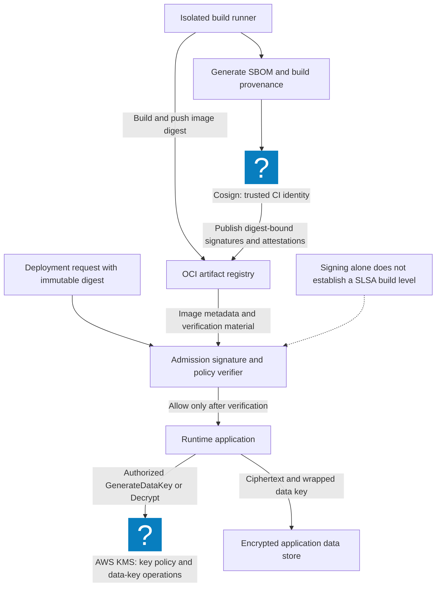
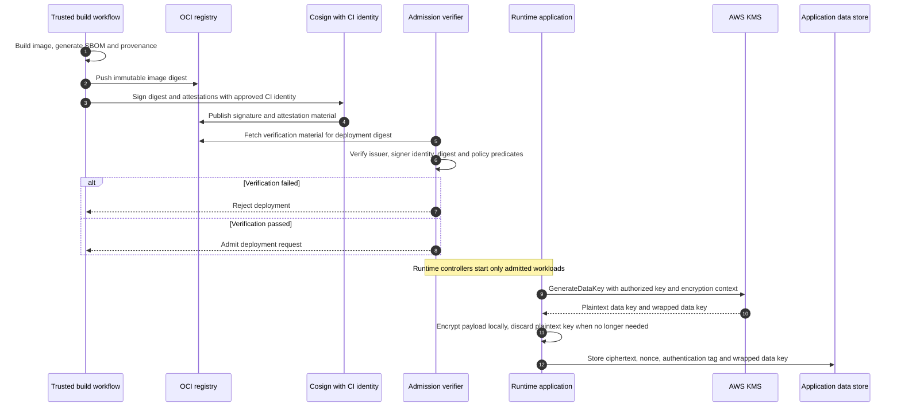

# Security Engineering Fundamentals: Verify the Artifact You Deploy

Reviewed: 2026-11-06 · Intermediate · 45–60 minutes

## Why this lab changed

A dependency list, a signed statement, and trustworthy build provenance answer different questions. [SLSA v1.2](https://slsa.dev/spec/v1.2/) organizes supply-chain guarantees into tracks and levels. This exercise teaches consumer verification without claiming that a local signature satisfies a SLSA level.

You will check a real signature, the artifact digest, the approved builder, and the approved source revision. The test suite deliberately rejects a statement that has a valid signature but names an unapproved builder.

## Prerequisites and scope

- Python 3.10 or newer and OpenSSL 1.1.1 or newer.
- [Artifact-integrity exercise](/labs/examples/artifact-integrity.py).
- No registry, signing service, cloud identity, or package installation is needed.

The local program creates a temporary RSA key pair and signs a small provenance-shaped statement. Its public key is the test's pre-established trust anchor. This is not Sigstore keyless signing, an SBOM generator, or a complete provenance-schema verifier.

## Production integration reference



The registry, CI identity, SBOM, and admission components belong to the production extension. The exercise implements a small verifier locally and does not deploy any of them.

## Exercise 1: run the verification chain

```bash
openssl version
python3 public/labs/examples/artifact-integrity.py
```

For a downloaded copy, inspect the script and run `python3 artifact-integrity.py`.

Expect five passing tests. The signed statement verifies first. The verifier then compares the digest against the exact artifact bytes and checks its builder and source policy. The program signs different fixtures in separate test cases, so a cryptographically valid statement can still fail authorization policy.

## Exercise 2: distinguish the failure modes

| Change | Required rejection |
| --- | --- |
| Modify artifact bytes | Digest mismatch |
| Modify statement after signing | Signature failure |
| Sign an unapproved builder claim | Builder-policy failure |
| Sign an unapproved source revision | Source-policy failure |

Add a second trusted key and a key-removal scenario. Establish the trusted key independently; accepting a public key supplied beside an artifact without a trust policy would let an attacker replace both.



## Exercise 3: design the real release gate

Record the expected repository, workflow identity, protected ref or approved commit, builder, artifact digest, and predicate type. Fail closed if required evidence cannot be verified. Pin artifacts by digest after verification so a mutable tag cannot select different bytes later.

For a real Sigstore deployment, follow [Cosign verification guidance](https://docs.sigstore.dev/cosign/verifying/verify/) and bind both signer identity and OIDC issuer. Evaluate verified predicate contents after checking the signature. Do not disable claim or transparency checks to turn a failure into a pass.

[GitHub artifact attestations](https://docs.github.com/en/actions/concepts/security/artifact-attestations) connect release artifacts with workflow provenance. [GitHub OIDC](https://docs.github.com/en/actions/concepts/security/openid-connect) can replace stored cloud deployment secrets with constrained short-lived access. Neither feature makes an arbitrary workflow trustworthy by itself.

## Expected evidence, troubleshooting, and cleanup

Save the five test results and a release-policy table. Keep SBOM completeness, vulnerability applicability, provenance authenticity, and deploy authorization as separate checks. A signed vulnerable artifact remains vulnerable.

If OpenSSL is unavailable, install a supported build before running the exercise. Do not replace signature verification with a plain checksum comparison: an attacker able to replace a file can often replace an adjacent checksum too.

The suite removes its temporary keys, statements, and signatures after each test. It performs no network requests. Full CI isolation, reproducibility, key management, and admission enforcement require separate environment testing. Continue with the [supply-chain field note](/blog/Trusted-Artifacts-SLSA-2026).
