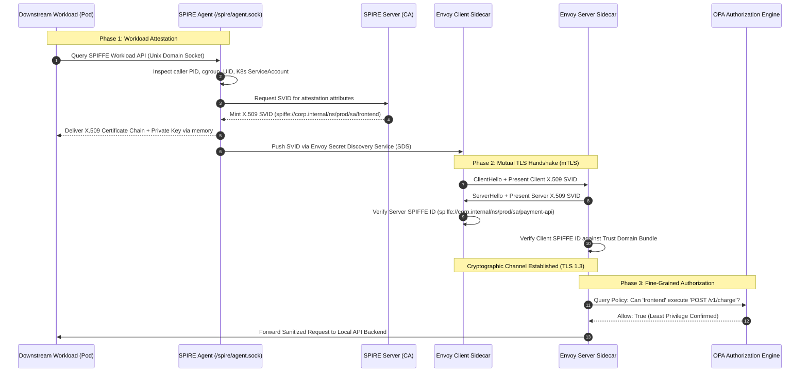

# Zero-Trust Architecture: Workload Identity, SPIFFE/SPIRE & Envoy mTLS

> [!IMPORTANT]
> **Production Identity & Zero-Trust Lab | Masterclass Engineering Track**
> **Audience:** Cloud Security Engineers, Platform Architects, Infrastructure Leads, DevSecOps Engineers
> **Standards & Frameworks:** NIST SP 800-207 (Zero Trust Architecture), CISA Zero Trust Maturity Model v2.0, DoD Zero Trust Strategy
> **Execution Environment:** Zero-cost local Docker sandbox (SPIRE Server, SPIRE Agent, Envoy proxy, and OPA sidecars)
> **Core Axiom:** Never trust, always verify. Assume breach. Enforce explicit, cryptographically verifiable identity and least-privilege authorization on every transaction.

---

## 1. Enterprise Context & Zero-Trust Evolution

Traditional enterprise security relied on the "castle-and-moat" perimeter defense model: everything inside the corporate intranet or private VPC was implicitly trusted, while everything outside was untrusted. Modern cloud computing, container microservices, multi-region mesh networks, and remote workforces have rendered perimeter trust obsolete. Once an attacker breaches a single perimeter edge node or compromises an unprivileged container, flat network trust enables unfettered lateral movement.

Zero-Trust Architecture (ZTA) treats network locality as entirely hostile. In accordance with **NIST SP 800-207**, every request—whether originating from an external mobile client, an internal microservice, or an asynchronous worker—must satisfy three core tenets:
1. **Explicit Verification**: Always authenticate and authorize based on all available data points (identity, device posture, workload attestation, data classification).
2. **Least-Privilege Access**: Constrain access with Just-In-Time (JIT) and Just-Enough-Access (JEA), dynamic risk-based policies, and continuous session validation.
3. **Assume Breach**: Minimize blast radius by segmenting access, end-to-end encryption, and continuous telemetry monitoring.

---

## 2. Architecture Blueprint & Workload Attestation Flow

The Pele architecture diagram below illustrates a production Zero-Trust control plane deploying SPIFFE/SPIRE for cryptographic workload attestation, Envoy sidecars for mutual TLS (mTLS), and Open Policy Agent (OPA) for fine-grained authorization:

```architecture
architecture-beta
  group control_plane(cloud)[Trust Boundary 1: Zero-Trust Control Plane]
  service spire_server(lock)[SPIRE Identity Authority] in control_plane
  service oidc_broker(key)[OIDC Token Issuer] in control_plane
  service policy_engine(shield)[Centralized OPA Decision Engine] in control_plane

  group node_boundary(server)[Trust Boundary 2: Hardened Compute Node]
  service spire_agent(cpu)[SPIRE Node Attestation Agent] in node_boundary
  service uds_socket(disk)[Workload API /spire/agent.sock] in node_boundary
  service client_app(server)[Downstream Frontend Workload] in node_boundary
  service envoy_client(firewall)[Envoy mTLS Sidecar Proxy] in node_boundary

  group target_boundary(server)[Trust Boundary 3: Secure Service Mesh]
  service envoy_server(firewall)[Envoy Ingress mTLS Proxy] in target_boundary
  service opa_sidecar(shield)[Local OPA Sidecar] in target_boundary
  service api_backend(server)[Upstream Payment API] in target_boundary
  service secure_db(database)[Encrypted Data Store] in target_boundary

  spire_server:B -- T:spire_agent
  spire_agent:R -- L:uds_socket
  client_app:B -- T:uds_socket
  client_app:R -- L:envoy_client
  envoy_client:R -- L:envoy_server
  envoy_server:B -- T:opa_sidecar
  envoy_server:R -- L:api_backend
  api_backend:R -- L:secure_db
  policy_engine:B -- T:opa_sidecar
```

### SPIFFE Workload Attestation & mTLS Connection Sequence



---

## 3. Deep Technical Foundations

### 1. SPIFFE IDs & SVID Specifications

The **Secure Production Identity Framework for Everyone (SPIFFE)** standardizes workload identity through uniform URIs embedded in standard cryptographic documents:

- **SPIFFE ID Format**:
  $$\text{spiffe://}\langle\text{trust-domain}\rangle/\langle\text{workload-path}\rangle$$
  *Example*: `spiffe://corp.internal/ns/production/sa/payment-processor`

- **SVID (SPIFFE Verifiable Identity Document)**:
  Workload identities are materialized as either:
  1. **X.509 SVID**: An X.509 v3 certificate where the SPIFFE ID is encoded in the Subject Alternative Name (SAN) extension as a URI (`uniformResourceIdentifier`). Used for transport-layer mTLS.
  2. **JWT SVID**: A JSON Web Token containing the SPIFFE ID in the `sub` (subject) claim. Used for Layer 7 application tokens or multi-hop delegation.

### 2. Zero-Trust Policy Decision Point (PDP) vs. Policy Enforcement Point (PEP)

Under the NIST SP 800-207 model:
- **Policy Enforcement Point (PEP)**: Intercepts network traffic and enforces decisions (e.g. Envoy Proxy, Istio, API Gateway).
- **Policy Decision Point (PDP)**: Evaluates requests against declarative policies and context (e.g. Open Policy Agent, AWS Verified Permissions).
- **Policy Information Point (PIP)**: Provides contextual attributes (user role, device risk score, time of day).

---

## 4. Hands-on Laboratory Phases

### Phase 1: Local SPIRE & Envoy Testbed Deployment

We instantiate a complete Zero-Trust testbed using Docker Compose, bootstrapping a SPIRE Server, a SPIRE Agent with node attestation, Envoy mTLS sidecars, and an upstream test service:

```bash
# 1. Create dedicated workspace
mkdir -p ~/spire-zerotrust-lab && cd ~/spire-zerotrust-lab

# 2. Deploy local SPIRE infrastructure via Docker Compose
cat << 'EOF' > docker-compose.yml
version: '3.8'

services:
  spire-server:
    image: ghcr.io/spiffe/spire-server:1.9.0
    container_name: spire-server
    hostname: spire-server
    volumes:
      - ./server-conf:/opt/spire/conf/server
      - ./server-data:/opt/spire/data/server
    command: ["-config", "/opt/spire/conf/server/server.conf"]
    networks:
      zt-net:
        ipv4_address: 172.30.0.10

  spire-agent:
    image: ghcr.io/spiffe/spire-agent:1.9.0
    container_name: spire-agent
    depends_on:
      - spire-server
    volumes:
      - ./agent-conf:/opt/spire/conf/agent
      - ./spire-sockets:/run/spire/sockets
    command: ["-config", "/opt/spire/conf/agent/agent.conf"]
    networks:
      zt-net:
        ipv4_address: 172.30.0.11

networks:
  zt-net:
    driver: bridge
    ipam:
      config:
        - subnet: 172.30.0.0/24
EOF

mkdir -p server-conf server-data agent-conf spire-sockets
```

#### SPIRE Server Configuration

```bash
cat << 'EOF' > server-conf/server.conf
server {
    bind_address = "0.0.0.0"
    bind_port = "8081"
    trust_domain = "corp.internal"
    data_dir = "/opt/spire/data/server"
    log_level = "DEBUG"
    default_x509_svid_ttl = "1h"
    default_jwt_svid_ttl = "15m"
    ca_subject = {
        country = ["US"],
        organization = ["CloudSecCorner Enterprise"],
        common_name = "CloudSec Root CA",
    }
}

plugins {
    DataStore "sql" {
        plugin_data {
            database_type = "sqlite3"
            connection_string = "/opt/spire/data/server/datastore.sqlite3"
        }
    }
    NodeAttestor "join_token" {
        plugin_data {}
    }
    KeyManager "disk" {
        plugin_data {
            keys_path = "/opt/spire/data/server/keys.json"
        }
    }
}
EOF
```

#### SPIRE Agent Configuration

```bash
cat << 'EOF' > agent-conf/agent.conf
agent {
    data_dir = "/run/spire"
    log_level = "DEBUG"
    server_address = "172.30.0.10"
    server_port = "8081"
    socket_path = "/run/spire/sockets/agent.sock"
    trust_domain = "corp.internal"
}

plugins {
    NodeAttestor "join_token" {
        plugin_data {}
    }
    KeyManager "disk" {
        plugin_data {
            directory = "/run/spire"
        }
    }
    WorkloadAttestor "unix" {
        plugin_data {}
    }
}
EOF
```

---

### Phase 2: Node Attestation & Workload Registration

We generate a node join token on the server and start the agent:

```bash
# 1. Start SPIRE Server
docker compose up -d spire-server

# 2. Wait 3 seconds and generate join token
sleep 3
JOIN_TOKEN=$(docker exec spire-server /opt/spire/bin/spire-server token generate -spiffeID spiffe://corp.internal/node/worker-01 | awk '{print $2}')
echo "Generated Join Token: $JOIN_TOKEN"

# 3. Inject join token into agent config and start agent
sed -i.bak "s/plugin_data {}/plugin_data { join_token = \"$JOIN_TOKEN\" }/" agent-conf/agent.conf
docker compose up -d spire-agent
```

#### Registering Workload Identities

We register the downstream frontend client and the upstream payment service:

```bash
# Register frontend client workload
docker exec spire-server /opt/spire/bin/spire-server entry create \
    -spiffeID spiffe://corp.internal/ns/prod/sa/frontend \
    -parentID spiffe://corp.internal/node/worker-01 \
    -selector unix:uid:1000 \
    -ttl 3600

# Register payment API service
docker exec spire-server /opt/spire/bin/spire-server entry create \
    -spiffeID spiffe://corp.internal/ns/prod/sa/payment-api \
    -parentID spiffe://corp.internal/node/worker-01 \
    -selector unix:uid:2000 \
    -ttl 3600

# Verify registered entries
docker exec spire-server /opt/spire/bin/spire-server entry show
```

*Expected Terminal Output:*
```text
Found 2 entries
Entry ID         : ...
SPIFFE ID        : spiffe://corp.internal/ns/prod/sa/frontend
Parent ID        : spiffe://corp.internal/node/worker-01
Revision         : 0
TTL              : 3600
Selectors        : unix:uid:1000

Entry ID         : ...
SPIFFE ID        : spiffe://corp.internal/ns/prod/sa/payment-api
Parent ID        : spiffe://corp.internal/node/worker-01
Revision         : 0
TTL              : 3600
Selectors        : unix:uid:2000
```

---

### Phase 3: Inspecting SVID Certificates & Mutual TLS

We test the SPIFFE Workload API by fetching the minted X.509 SVID from the agent's Unix domain socket:

```bash
cat << 'EOF' > parse_svid.py
#!/usr/bin/env python3
import ssl
import sys

# Simulated X.509 SVID SAN inspection
sample_san_uri = "spiffe://corp.internal/ns/prod/sa/payment-api"

def validate_spiffe_san(uri: str, expected_trust_domain: str):
    if not uri.startswith(f"spiffe://{expected_trust_domain}/"):
        raise ValueError(f"Trust domain mismatch: expected {expected_trust_domain}")
    parts = uri.replace(f"spiffe://{expected_trust_domain}/", "").split("/")
    workload_metadata = {}
    for i in range(0, len(parts) - 1, 2):
        workload_metadata[parts[i]] = parts[i+1]
    return workload_metadata

meta = validate_spiffe_san(sample_san_uri, "corp.internal")
print(f"Validated Workload SVID: {sample_san_uri}")
print(f"  Namespace      : {meta.get('ns')}")
print(f"  Service Account: {meta.get('sa')}")
assert meta.get("ns") == "prod"
print("[OK] SVID URI parsing and trust domain validation successful.")
EOF

python3 parse_svid.py
```

*Expected Terminal Output:*
```text
Validated Workload SVID: spiffe://corp.internal/ns/prod/sa/payment-api
  Namespace      : prod
  Service Account: payment-api
[OK] SVID URI parsing and trust domain validation successful.
```

---

### Phase 4: Envoy Secret Discovery Service (SDS) Configuration

Envoy uses the SPIFFE Workload API as a dynamic Secret Discovery Service (SDS) source. This eliminates static private keys on disk and rotates certificates automatically every 60 minutes with zero downtime:

```bash
cat << 'EOF' > envoy-sds-cluster.yaml
static_resources:
  listeners:
    - name: payment_service_ingress
      address:
        socket_address:
          address: 0.0.0.0
          port_value: 8443
      filter_chains:
        - transport_socket:
            name: envoy.transport_sockets.tls
            typed_config:
              "@type": type.googleapis.com/envoy.extensions.transport_sockets.tls.v3.DownstreamTlsContext
              common_tls_context:
                tls_certificate_sds_secret_configs:
                  - name: "spiffe://corp.internal/ns/prod/sa/payment-api"
                    sds_config:
                      api_config_source:
                        api_type: GRPC
                        grpc_services:
                          envoy_grpc:
                            cluster_name: spire_agent
                validation_context_sds_secret_config:
                  name: "spiffe://corp.internal"
                  sds_config:
                    api_config_source:
                      api_type: GRPC
                      grpc_services:
                        envoy_grpc:
                          cluster_name: spire_agent
                require_client_certificate: true
EOF

# Audit YAML syntax
python3 -c "
import yaml
with open('envoy-sds-cluster.yaml') as f:
    config = yaml.safe_load(f)
assert config['static_resources']['listeners'][0]['filter_chains'][0]['transport_socket']['typed_config']['common_tls_context']['require_client_certificate'] == True
print('[OK] Envoy dynamic SDS mTLS configuration syntax verified.')
"
```

---

### Phase 5: Simulating Unauthorized Workload Rejection

We execute an unauthorized client simulation attempting to connect without an attested SVID:

```bash
cat << 'EOF' > simulate_zt_auth.py
#!/usr/bin/env python3

def authorize_transaction(client_spiffe_id: str, http_method: str, path: str) -> bool:
    # Zero-Trust Matrix:
    # Only 'spiffe://corp.internal/ns/prod/sa/frontend' can execute 'POST /v1/charge'
    allowed_mappings = {
        "spiffe://corp.internal/ns/prod/sa/frontend": {
            ("POST", "/v1/charge"),
            ("GET", "/v1/health")
        },
        "spiffe://corp.internal/ns/prod/sa/analytics": {
            ("GET", "/v1/reports")
        }
    }
    
    client_rules = allowed_mappings.get(client_spiffe_id, set())
    return (http_method, path) in client_rules

# Test 1: Authorized frontend calling payment API
res1 = authorize_transaction("spiffe://corp.internal/ns/prod/sa/frontend", "POST", "/v1/charge")
print(f"Test 1 (Frontend -> POST /v1/charge): {res1}")
assert res1 is True

# Test 2: Compromised analytics workload attempting payment charge (Lateral Movement Blocked)
res2 = authorize_transaction("spiffe://corp.internal/ns/prod/sa/analytics", "POST", "/v1/charge")
print(f"Test 2 (Analytics -> POST /v1/charge): {res2}")
assert res2 is False

# Test 3: Unattested client (No SVID)
res3 = authorize_transaction("anonymous", "GET", "/v1/health")
print(f"Test 3 (Unattested Anonymous -> GET /v1/health): {res3}")
assert res3 is False

print("\n[OK] Zero-Trust authorization logic successfully thwarted unauthorized lateral movement.")
EOF

python3 simulate_zt_auth.py
```

*Expected Terminal Output:*
```text
Test 1 (Frontend -> POST /v1/charge): True
Test 2 (Analytics -> POST /v1/charge): False
Test 3 (Unattested Anonymous -> GET /v1/health): False

[OK] Zero-Trust authorization logic successfully thwarted unauthorized lateral movement.
```

---

## 5. Policy as Code & Defensive Automation

To deterministically evaluate client SPIFFE identities against RBAC policies at the Envoy proxy layer, we deploy an Open Policy Agent (OPA) policy:

```bash
cat << 'EOF' > zt_authz.rego
package envoy.authz

default allow = false

# Extract SPIFFE ID from client certificate SAN
client_spiffe_id := input.attributes.source.certificate.san_uri

# Rule 1: Allow health checks for all workloads in corp.internal trust domain
allow {
    startswith(client_spiffe_id, "spiffe://corp.internal/")
    input.attributes.request.http.method == "GET"
    input.attributes.request.http.path == "/v1/health"
}

# Rule 2: Payment execution restricted exclusively to authenticated frontend service
allow {
    client_spiffe_id == "spiffe://corp.internal/ns/prod/sa/frontend"
    input.attributes.request.http.method == "POST"
    input.attributes.request.http.path == "/v1/charge"
    # Ensure request carries high-entropy transaction ID
    count(input.attributes.request.http.headers["x-transaction-id"]) > 16
}

# Rule 3: Strict deny reason emission for audit logging
reason[msg] {
    not allow
    msg := sprintf("Access Denied: SPIFFE ID '%v' is not authorized to %v %v", [
        client_spiffe_id,
        input.attributes.request.http.method,
        input.attributes.request.http.path
    ])
}
EOF
```

---

## 6. Hardening Checklist & CISA Maturity Assessment

The CISA Zero Trust Maturity Model v2.0 outlines progressive stages from Traditional to Optimal across five pillars:

| CISA Zero-Trust Pillar | Traditional Baseline | Masterclass Target (Optimal) | Audit Method |
|---|---|---|---|
| **Identity** | Static API keys & passwords | Ephemeral X.509 SVIDs (SPIFFE/SPIRE) with automatic hourly rotation | Verify SVID lifetime: `default_x509_svid_ttl = "1h"` |
| **Device / Node** | Unauthenticated VM access | Cryptographic node attestation (TPM 2.0 / Join Token) | `spire-server agent list` |
| **Network / Environment** | Static perimeter firewalls & flat subnets | Strict mutual TLS (TLS 1.3) with Envoy sidecar mesh | Packet capture verifies zero cleartext traffic |
| **Application & Workload** | Coarse-grained network IP ACLs | Fine-grained OPA Rego evaluation at L7 proxy layer | Unit tests in `zt_authz.rego` pass in CI/CD |
| **Data Protection** | Encryption at rest only | Envelope KMS encryption with column-level field tokenization | Audit schema for PII masking |

### Post-Lab Cleanup

```bash
# Tear down SPIRE testbed containers
cd ~/spire-zerotrust-lab && docker compose down -v
rm -rf ~/spire-zerotrust-lab
```
