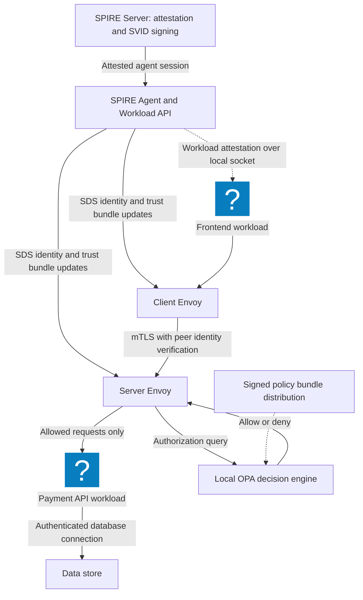
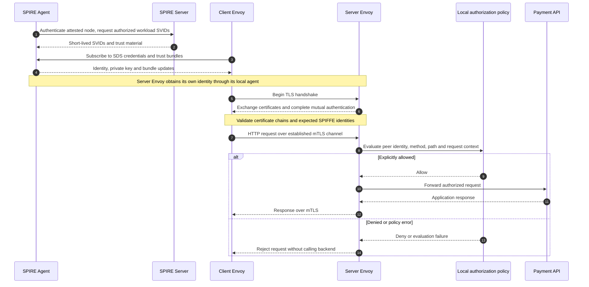

# Zero-Trust Architecture: Authenticate Workloads, Authorize Requests

Reviewed: 2026-11-06 · Intermediate · 45–60 minutes

## Why this lab changed

Cloud services, CI jobs, and agents all need identities whose permissions are narrower than a shared environment credential. This exercise separates certificate authentication from application authorization using a real local TLS connection.

[SPIFFE](https://spiffe.io/docs/latest/spiffe-about/spiffe-concepts/) defines workload identities and SVIDs. Here, OpenSSL creates temporary certificates containing SPIFFE-shaped URI names. This is a small PKI teaching fixture, not a SPIRE installation, conformant SVID issuer, attestation system, or automatic rotation service.

## Prerequisites and scope

- Python 3.10 or newer and OpenSSL 1.1.1 or newer on `PATH`.
- Permission to bind an ephemeral port on `127.0.0.1`.
- [Exercise download](/labs/examples/workload-identity.py). No external connections, root privileges, or cloud credentials are needed.

The script generates a disposable CA, a server certificate, and two client certificates. Private keys remain in a temporary directory and are removed after the suite. These one-day certificates are for this exercise only.

## Production integration reference



SPIRE and Envoy are shown as a production extension. The local exercise uses Python's TLS library instead. It does not require Docker, SPIRE, or Envoy and does not simulate their attestation guarantees.

## Exercise 1: establish a real mTLS boundary

```bash
openssl version
python3 public/labs/examples/workload-identity.py
```

Without a checkout, download the script into a dedicated folder and run that copy:

```bash
curl -fsSLo workload-identity.py https://cloudsecuritycorner.com/labs/examples/workload-identity.py
# Inspect the downloaded file before running it.
python3 workload-identity.py
```

Expect five passing tests. Both clients have certificates from the same CA. Only the `frontend` URI identity can access `/evidence`; `analytics` receives HTTP 403. A client without a certificate fails the TLS exchange. A client that does not trust the server CA also fails certificate verification.

## Exercise 2: try an identity-header substitution

The analytics client sends a header claiming to be the frontend. The server reads the identity from the verified peer certificate rather than that header, so the request still receives 403.

Add a second permitted route and a second identity. Specify the identity/route matrix before editing the handler. An authenticated frontend requesting `/admin` must remain forbidden. Capture the distinction between a TLS failure and an authenticated-but-denied application request.



## Expected evidence and acceptance criteria

| Caller | `/evidence` result |
| --- | --- |
| Trusted frontend certificate | HTTP 200 |
| Trusted analytics certificate | HTTP 403 |
| Analytics plus forged identity header | HTTP 403 |
| No client certificate | TLS failure |
| Client without trusted server CA | Certificate verification failure |

Never use `curl -k` or disable certificate checks to make a failure disappear. A certificate from a trusted CA identifies a peer; the application still has to authorize the resource and operation.

## Production extension, troubleshooting, and cleanup

Introduce SPIRE node/workload attestation, automatic certificate renewal, and explicit trust-bundle updates using the [SPIRE documentation](https://spiffe.io/docs/latest/spire-about/spire-concepts/). Test an old and a new trust bundle during rotation. Compare connection reuse with new TLS handshakes when evaluating revocation or expiry behavior.

If OpenSSL fails, inspect its version and command support. If loopback sockets are blocked by a managed environment, run locally with that permission rather than weakening TLS. If a connection hangs, check that another test has not been manually stopped before its cleanup completes.

The suite stops its server, joins its thread, and deletes the temporary certificates and keys. This exercise establishes local authentication and authorization behavior; it does not verify distributed credential rotation or production trust-domain federation. Continue with [agent authorization](/labs/Agentic-Cloud-Security).
