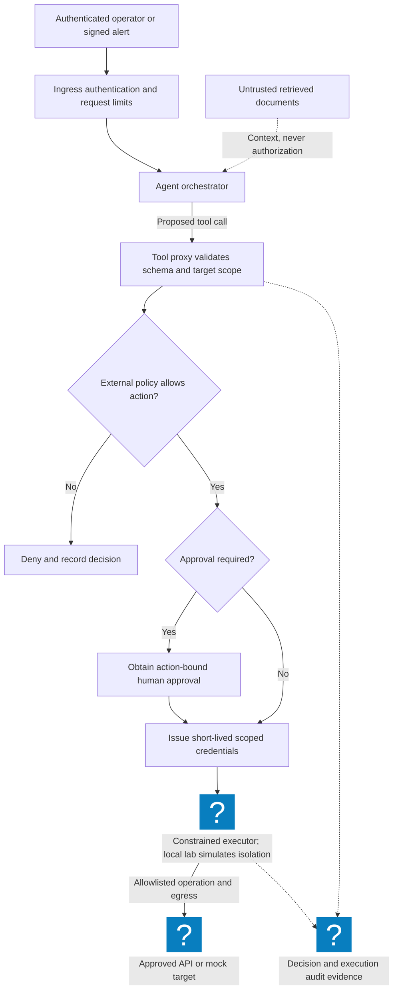
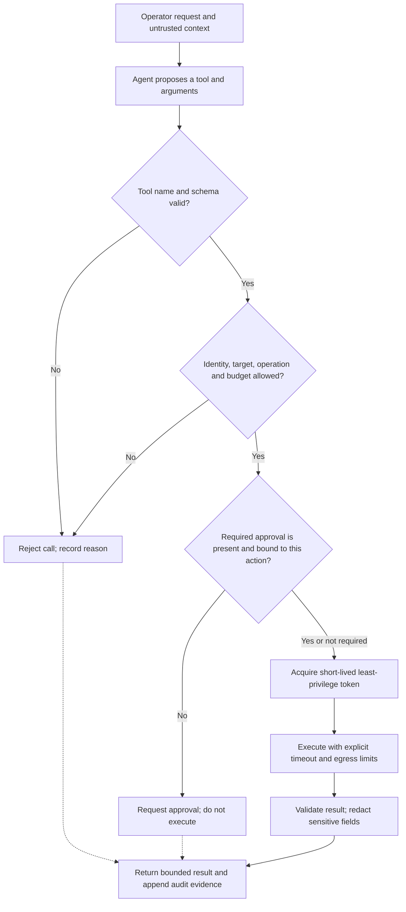

# Agentic Cloud Security: Tool Authorization and Approval Boundaries

Reviewed: 2026-11-06 · Intermediate · 45–60 minutes

## Why this lab changed

The [MCP 2026-07-28 release](https://blog.modelcontextprotocol.io/posts/2026-07-28/) changes transport and discovery assumptions. Pin the protocol and SDK revision when adapting older examples. This lab focuses on the application boundary that remains essential across revisions: an agent proposes an action, while trusted code decides whether it may execute.

You will reject cross-tenant access, unexpected arguments, over-budget calls, missing approvals, changed actions, and approval replay. A successful prompt is never an authorization decision.

## Prerequisites and scope

- Python 3.10 or newer. No model key, cloud account, package installation, or external API is required.
- Use synthetic ticket and evidence identifiers only.
- Download the [complete exercise source](/labs/examples/agent-boundary.py) and inspect it before execution.

The exercise returns mock receipts. It does not implement MCP transport, OAuth token verification, durable approval storage, or an execution sandbox. The principal is a trusted test fixture supplied after authentication; accepting that value from request JSON would break the design.

## Architecture and trust boundaries



This is the production integration reference. The local exercise implements the policy and approval portion, with no credential broker or cloud executor. Keep untrusted retrieved text separate from the principal, permitted tenant, and approval record.

## Exercise 1: run positive and negative cases

From a repository checkout:

```bash
python3 public/labs/examples/agent-boundary.py
```

Or use a downloaded copy:

```bash
mkdir -p csc-agent-lab
cd csc-agent-lab
curl -fsSLo agent-boundary.py https://cloudsecuritycorner.com/labs/examples/agent-boundary.py
# Inspect the downloaded file, then run it.
python3 agent-boundary.py
```

Expect six passing tests. The approved read succeeds. An evidence write requires a valid HMAC approval bound to the entire canonical action, a future expiry, and a nonce that has not been consumed. The signing key exists only in memory for this exercise.

## Exercise 2: change the action after approval

Read `test_action_changed_after_approval`. The test changes the byte budget after a human-equivalent fixture approves the original request. The signature can still be authentic while the action binding is wrong; the gateway must reject it.

Add a target-change case, an unknown tool, a boolean byte count, and an expired approval at the exact expiry time. Require every denial to happen before a side effect. Record a decision ID, policy revision, principal, action digest, and result without storing bearer tokens or complete sensitive prompts.



## Expected evidence and acceptance criteria

| Case | Required result |
| --- | --- |
| Approved tenant A read | Allow mock receipt |
| Same action in tenant B | Deny |
| Write without approval | Deny |
| Signed approval reused | Deny |
| Arguments changed after approval | Deny |
| Unknown argument or excessive bytes | Deny |

Save the test output and one redacted denial record. Passing these tests demonstrates this local policy boundary; it does not establish resistance to every prompt-injection attack.

## Production extension and cleanup

For an HTTP MCP server, validate tokens for that server's intended audience and obtain downstream credentials through an explicit authorized flow. Do not forward an arbitrary inbound bearer token to another service. Follow the [MCP authorization specification](https://modelcontextprotocol.io/specification/2026-07-28/basic/authorization) and [MCP security guidance](https://modelcontextprotocol.io/docs/2026-07-28/tutorials/security/security_best_practices).

Replace the in-memory nonce set with atomic, durable consumption shared by all replicas. Add an egress allowlist, per-task limits, cancellation, and tests against the actual tool adapter. Review the exercise against the [OWASP Agentic Applications 2026 resource](https://genai.owasp.org/resource/owasp-top-10-for-agentic-applications-for-2026/).

The program creates no files and performs no network calls. Remove only your downloaded exercise folder when finished. Continue with [workload identity](/labs/Zero-Trust-Architecture) or the [MCP migration field note](/blog/MCP-Security-2026).
