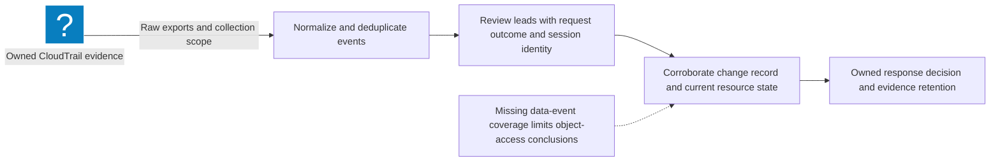

# CloudTrail Triage: Build an Evidence Timeline

Reviewed: 2026-11-07 · Intermediate · 50 minutes

A high-value event is an investigation lead. It becomes useful when you can explain the principal, action, outcome, region, affected resource, and missing evidence. This exercise builds that review queue from real CloudTrail export shapes using synthetic examples first.

## Prerequisites and scope

- Python 3.10 or newer and the [CloudTrail triage exercise](/labs/examples/aws-cloudtrail-triage.py).
- No AWS account is required for the default tests.
- Optional exports require an authorized profile with CloudTrail lookup access in each intended account and region. The parser accepts `lookup-events` JSON, trail `Records` JSON, and gzip-compressed copies.

[Event history](https://docs.aws.amazon.com/awscloudtrail/latest/userguide/view-cloudtrail-events.html) contains recent management events by account and region. Its 90-day view is separate from a trail. It does not supply the S3 object reads you would need to investigate object access; plan [data-event collection](https://docs.aws.amazon.com/awscloudtrail/latest/userguide/logging-data-events-with-cloudtrail.html) deliberately for those questions.

## Evidence workflow



## Exercise 1: distinguish a request from its result

```bash
python3 public/labs/examples/aws-cloudtrail-triage.py
python3 public/labs/examples/aws-cloudtrail-triage.py --sample > cloudtrail.json
python3 public/labs/examples/aws-cloudtrail-triage.py --events cloudtrail.json
```

Expect nine tests to pass. The synthetic queue contains a Lambda role binding and a denied logging-stop request. The latter must say `failed_request`, not that logging stopped. An event without an error says `no_error_recorded`; the checker does not infer downstream completion or attacker intent.

The parser extracts only a small evidence summary. It preserves the acting session's key identifier separately from the issuer role. Two events with the same issuer role need not come from the same session. Identical event IDs deduplicate; conflicting records with one event ID produce an input error for review.

[Lambda's CloudTrail event names](https://docs.aws.amazon.com/lambda/latest/dg/logging-using-cloudtrail.html) can include a date and version suffix, such as `CreateFunction20150331`. The exercise recognizes the documented creation/configuration/code-update names and retains both the original event name and its mapped API action.

## Exercise 2: collect a bounded, authorized export

Choose explicit timestamps suitable for your investigation. This example exports the previous hour:

```bash
aws sts get-caller-identity --profile sandbox-audit
TRIAGE_START_UTC=$(python3 -c 'from datetime import datetime, timedelta, timezone; print((datetime.now(timezone.utc)-timedelta(hours=1)).isoformat())')
TRIAGE_END_UTC=$(python3 -c 'from datetime import datetime, timezone; print(datetime.now(timezone.utc).isoformat())')
aws cloudtrail lookup-events --profile sandbox-audit --region us-east-1 \
  --start-time "$TRIAGE_START_UTC" --end-time "$TRIAGE_END_UTC" \
  --output json > lookup.json
python3 aws-cloudtrail-triage.py --events lookup.json
```

The [CLI lookup operation](https://docs.aws.amazon.com/cli/latest/reference/cloudtrail/lookup-events.html) is paginated; keep automatic pagination enabled and avoid accidentally truncating your evidence with `--no-paginate` or a small `--max-items`. Repeat collection for other in-scope regions and accounts. Record collection times and preserve the original exports beside your notes.

## Exercise 3: test the claims you could make

| Observation | Defensible next step |
| --- | --- |
| `CreateAccessKey` | Verify target identity, owner, and whether the key was later used |
| `PutRolePolicy` or trust change | Compare the policy and approved change record |
| Denied `StopLogging` | Investigate the attempt and verify trail status separately |
| Lambda `CreateFunction` with a role | Review deployer permissions, role trust, and runtime policy |
| No queued S3 object-read event | Verify collection coverage before making an access claim |

[CloudTrail's record fields](https://docs.aws.amazon.com/awscloudtrail/latest/userguide/cloudtrail-event-reference-record-contents.html) vary by service and event. A role binding appears on the resource-changing service action; [PassRole itself is not an API event](https://docs.aws.amazon.com/IAM/latest/UserGuide/id_roles_use_passrole.html).

## Expected evidence and cleanup

Keep nine passing tests, a sorted queue, one verified failed request, and a coverage note listing account, region, time window, event types, and gaps. An empty queue means the supplied records did not match these few rules. It does not establish a clean account.

The script performs no API calls, containment, or credential changes. Remove temporary exports according to your evidence-retention process; retain authorized incident evidence where required. Finish the path with the [CloudTrail field note](/blog/AWS-CloudTrail-Triage) and revisit [credential ownership](/labs/AWS-Credential-Review) when a suspicious identity needs review.
