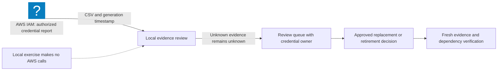

# AWS Credential Review: Turn a CSV Export into an Action Queue

Reviewed: 2026-11-07 · Foundation · 40 minutes

Start the AWS Defender path by answering a concrete question: which identities need an owner to review their credentials? Your deliverable is a small, reproducible queue with evidence and a follow-up decision.

## Prerequisites and scope

- Python 3.10 or newer; download the [credential-review exercise](/labs/examples/aws-credential-review.py).
- The default exercise uses synthetic records and requires no AWS account.
- For the optional export, use an authorized AWS CLI profile with `iam:GenerateCredentialReport` and `iam:GetCredentialReport`. Confirm its account with `aws sts get-caller-identity` first.

[AWS credential reports](https://docs.aws.amazon.com/IAM/latest/UserGuide/id_credentials_getting-report.html) describe IAM-managed credentials, not every credential or identity in an organization. Reports may be reused for four hours. They do not inventory role sessions, workforce federation, or service-specific credentials, and current AWS documentation identifies limits on the access-key slots included. Retain the report's generation time and supplement it with the relevant inventory APIs.

## Evidence flow



## Exercise 1: run the regression cases

```bash
python3 public/labs/examples/aws-credential-review.py
python3 public/labs/examples/aws-credential-review.py --demo
```

A downloaded copy runs as `python3 aws-credential-review.py`. Expect eight tests to pass. The demo intentionally exits with status `1` and prints review findings. That exit status is useful in a review gate; it does not mean the parser crashed. Invalid input exits with `2`.

The tests distinguish an active root key, console access without MFA, an old but recently used key, an inactive key, missing last-use evidence, and a root identity with no password or access keys. A missing timestamp creates an evidence question, rather than an invented inactivity duration.

## Exercise 2: analyze an authorized report

Request a report with `aws iam generate-credential-report --profile sandbox-audit`. If its state is not `COMPLETE`, wait briefly and request its status again before downloading it. Then:

```bash
aws iam get-credential-report --profile sandbox-audit --output json > credential-report.json
python3 - <<'PY'
import base64, json
from pathlib import Path
report = json.loads(Path('credential-report.json').read_text())
Path('credential-report.csv').write_bytes(base64.b64decode(report['Content']))
print('Report generated:', report['GeneratedTime'])
PY
python3 aws-credential-review.py --report credential-report.csv --age-days 90
```

The [CLI response](https://docs.aws.amazon.com/cli/latest/reference/iam/get-credential-report.html) supplies the encoded CSV and its generation metadata. The review timestamp defaults to now; `--as-of 2026-11-07T00:00:00Z` makes a synthetic exercise reproducible. Use an appropriate timestamp when reviewing real evidence.

## Exercise 3: separate findings from remediation

| Finding | Owner's next question |
| --- | --- |
| `ROOT_ACCESS_KEY` | Which dependency still uses this credential, and how will access be replaced? |
| `CONSOLE_WITHOUT_MFA` | Is direct console access still needed, and what authentication controls apply? |
| `KEY_AGE_REVIEW` | Is this long-lived key still justified and owned? |
| `KEY_INACTIVITY_REVIEW` | Can usage be corroborated before retirement? |
| `KEY_EVIDENCE_UNKNOWN` | Which additional evidence resolves the gap? |

The 90-day threshold is this exercise's adjustable review policy. It is not a universal AWS rotation mandate. Prefer workload roles and workforce federation where applicable, following [AWS IAM best practices](https://docs.aws.amazon.com/IAM/latest/UserGuide/best-practices.html). Do not disable a production credential solely because this worksheet flags it.

## Expected evidence and cleanup

Keep eight passing tests, the report generation timestamp, a queue with owners, and one proposed verification step. The program reads locally and never uploads reports or changes credentials. Remove local CSV/JSON exports after your evidence-retention decision; they contain account and identity information. Continue with [role delegation](/labs/AWS-Role-Delegation) and the [credential review field note](/blog/AWS-Credential-Review).
