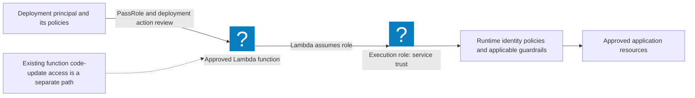

# AWS Role Delegation: Review What a Deployment Identity Can Hand Off

Reviewed: 2026-11-07 · Intermediate · 50 minutes

A deployment identity can gain practical access through a service it controls. Review the deployer, the execution role, and the application it can change as one system. This exercise produces a repeatable review of a deliberately narrow Lambda deployment contract.

## Prerequisites and scope

- Python 3.10 or newer and the [role-delegation exercise](/labs/examples/aws-role-delegation.py).
- No cloud account is required for the synthetic policy bundle.
- The checker covers specified `iam:PassRole` grants, selected Lambda deployment actions, and service trust. It does not calculate effective IAM authorization or assess every privilege-escalation route.

## Review the delegation boundary



AWS documents [PassRole as a permission to delegate a role to a service](https://docs.aws.amazon.com/IAM/latest/UserGuide/id_roles_use_passrole.html). It requires same-account service delegation. It is separate from the role's trust relationship and from its runtime permissions. The [Lambda execution-role documentation](https://docs.aws.amazon.com/lambda/latest/dg/lambda-intro-execution-role.html) describes the service trust needed for Lambda to assume that role.

## Exercise 1: inspect the contract

```bash
python3 public/labs/examples/aws-role-delegation.py
python3 public/labs/examples/aws-role-delegation.py --sample > delegation.json
python3 public/labs/examples/aws-role-delegation.py --bundle delegation.json
```

Expect eight passing tests and no findings for the sample contract. A downloaded script uses the same arguments without the repository path. The sample names fictional resources in account `111122223333` and grants no access by itself.

The deployment policy names one execution-role ARN and one function ARN. Its PassRole statement constrains `iam:PassedToService` to `lambda.amazonaws.com`. The trust policy names Lambda as its sole allowed service principal. Review [IAM condition-key support](https://docs.aws.amazon.com/IAM/latest/UserGuide/reference_policies_iam-condition-keys.html) before adapting the pattern to another service.

## Exercise 2: make the review fail

Edit a copy of `delegation.json`, then rerun the checker after each change:

| Change | Expected review finding |
| --- | --- |
| Replace the role resource with `*` | `PASSROLE_SCOPE` |
| Remove or change the destination service condition | `PASSROLE_SERVICE` |
| Allow code updates on every function | `DEPLOYMENT_SCOPE` |
| Add an unrelated trusted AWS principal | `TRUST_PRINCIPAL` |
| Use `NotAction` or `NotResource` in an allow | `MANUAL_POLICY_REVIEW` |

Findings exit with status `1`; invalid documents or target ARNs exit with `2`. For your own policies, pass exact `--role-arn` and `--function-arn` values. This workshop supports commercial AWS ARNs in one account and intentionally requires manual adaptation for other partitions or more complex policies.

## Exercise 3: check the permissions outside this contract

A scoped PassRole statement does not make broad `UpdateFunctionCode` access harmless: changing code on an existing function can use its existing execution role. Inspect the role's attached and inline permissions, other policies on the deployer, resource policies, session policies, boundaries, and organization controls. Follow the actual [AWS policy evaluation rules](https://docs.aws.amazon.com/IAM/latest/UserGuide/reference_policies_evaluation-logic.html); a zero-finding lint result is not an authorization verdict.

PassRole is not an API event. Investigate the service action that received the role, such as Lambda `CreateFunction`, and inspect its recorded role field. The [CloudTrail triage lab](/labs/AWS-CloudTrail-Triage) demonstrates that evidence using synthetic events.

## Expected evidence and cleanup

Save the original bundle, one failed case per boundary, and a table distinguishing deploy permission, service trust, and runtime access. The program performs no API calls and creates no cloud resources. Delete your temporary JSON bundle when finished. Continue with [S3 plan review](/labs/AWS-S3-Plan-Review) and the [delegation field note](/blog/AWS-Role-Delegation).
