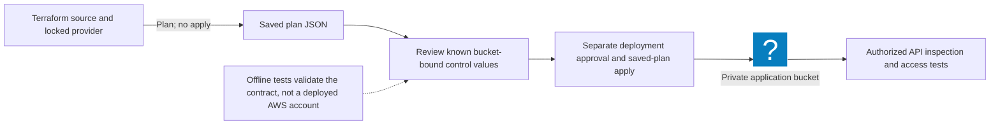

# Private S3 by Construction: Review the Plan Before Deployment

Reviewed: 2026-11-07 · Intermediate · 60 minutes

Write a small storage contract, generate deployment evidence, and reject changes that break that contract. The deliverable is a Terraform plan review with positive and negative cases for one root-module bucket.

## Prerequisites and scope

- Python 3.10 or newer; download the [plan checker](/labs/examples/aws-s3-plan-review.py) and [Terraform example](/labs/examples/aws-private-s3.tf).
- The sample-plan exercise requires no cloud account or Terraform installation.
- The optional provider-backed plan requires Terraform 1.6–1.x, AWS provider 6.x, network access for provider installation, and an authorized sandbox profile. Review your account and the plan before any separate deployment decision.

The checker expects `aws_s3_bucket.data`, one root-module resource of each named control type, and resolved bucket names. It deliberately rejects ambiguous or unknown values. It does not evaluate effective AWS permissions, access points, organization policy, arbitrary Terraform modules, or the full contents of every bucket-policy statement.

The configuration and checker were verified with Terraform 1.17.1 and AWS provider 6.72.0 using an isolated local plan. No AWS resources were deployed during that verification.

## Plan-to-evidence workflow



## Exercise 1: run the mutations

```bash
python3 public/labs/examples/aws-s3-plan-review.py
python3 public/labs/examples/aws-s3-plan-review.py --sample > s3-plan.json
python3 public/labs/examples/aws-s3-plan-review.py --plan s3-plan.json
```

Expect eight tests to pass and no findings for the synthetic baseline. Disable one public-access flag, remove versioning, change the control's bucket name, or make a required value unknown. The checker should report findings and exit `1`. Invalid or unsupported input exits `2`.

The [Terraform JSON specification](https://developer.hashicorp.com/terraform/internals/json-format) distinguishes planned values from values that remain unknown until apply. A reference to a bucket alone does not establish its final name. The example therefore uses the bucket's configured `bucket` attribute for its controls, keeping their target names known during planning.

## Exercise 2: inspect a real provider-backed plan

Create a new working directory, save the downloaded Terraform file there as `main.tf`, and keep the Python checker beside it. Choose your own globally unique sandbox bucket name:

```bash
export AWS_PROFILE=sandbox-audit
aws sts get-caller-identity
terraform init
terraform fmt -check
terraform validate
terraform plan -var='bucket_name=your-owned-unique-sandbox-name' -out=s3.tfplan
terraform show -json s3.tfplan > s3-plan.json
python3 aws-s3-plan-review.py --plan s3-plan.json
```

These commands do not apply the plan. Treat plan JSON and state as potentially sensitive. Keep the saved plan tied to its reviewed source revision, variables, provider lock file, account, and region. A future apply must use the reviewed plan rather than silently generating a different one.

## Exercise 3: explain each control's limit

| Contract | What still needs review |
| --- | --- |
| Four public-access flags enabled | Nonpublic cross-account grants and other access paths |
| `BucketOwnerEnforced` ownership | IAM and resource-policy authorization |
| Explicit SSE-S3 default | Whether the application needs a separately controlled KMS key |
| Versioning enabled | Delete permissions, retention, lifecycle, and recovery testing |
| Scoped insecure-transport deny | Service integrations and other policy statements |

[Block Public Access](https://docs.aws.amazon.com/AmazonS3/latest/userguide/access-control-block-public-access.html) and [Object Ownership](https://docs.aws.amazon.com/AmazonS3/latest/userguide/about-object-ownership.html) address different controls. [SSE-S3 is already the default for new uploads](https://docs.aws.amazon.com/AmazonS3/latest/userguide/UsingServerSideEncryption.html); encryption alone does not restrict readers. The example's transport deny follows AWS guidance to account for [service-principal network context](https://docs.aws.amazon.com/AmazonS3/latest/userguide/amazon-s3-policy-keys.html).

## Expected evidence and cleanup

Keep the eight test results, a validated plan, and one failing mutation. If you independently deploy the sandbox, verify its settings through authorized S3 APIs and test expected application access. No deployment was performed by this local checker.

The template sets `force_destroy = false`. An empty example can be removed with a separately reviewed destroy plan; a versioned bucket with data requires an intentional versions/delete-marker retention decision first. Do not empty a real data bucket as a cleanup shortcut. For a plan-only exercise, remove the local plan, JSON, provider cache, and temporary directory. Continue with [CloudTrail evidence](/labs/AWS-CloudTrail-Triage) and the [S3 field note](/blog/AWS-S3-Plan-Review).
