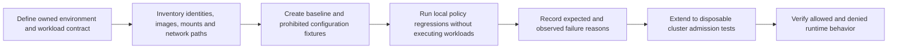
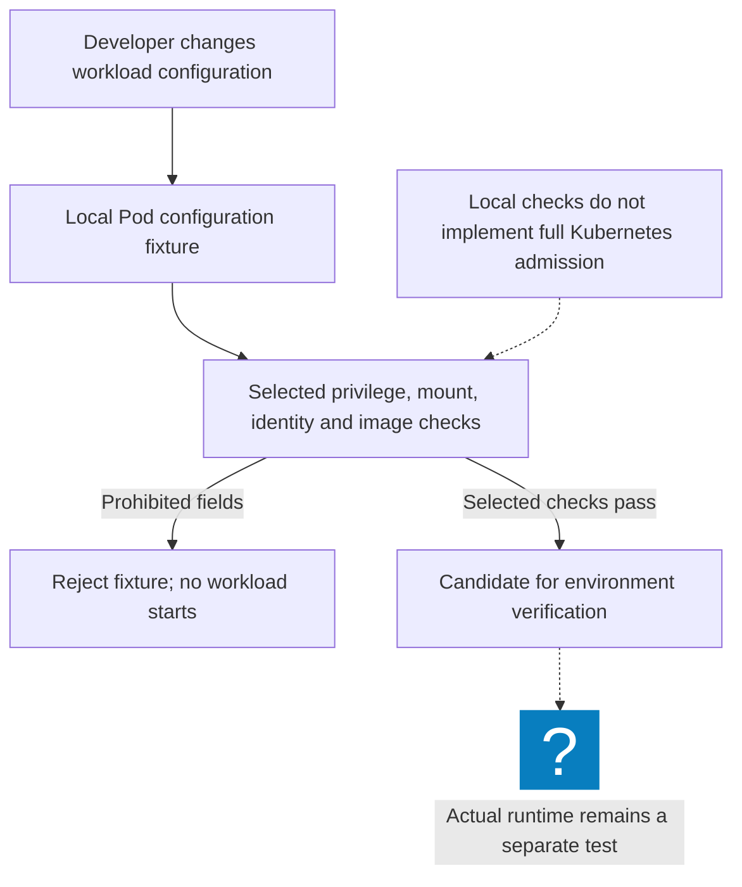
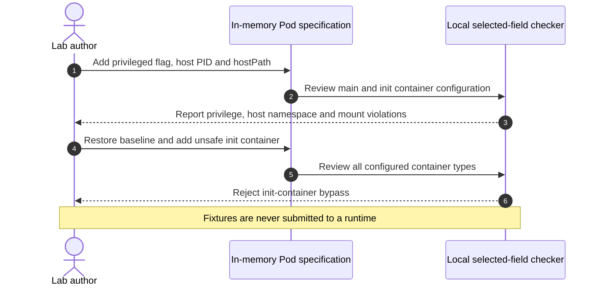
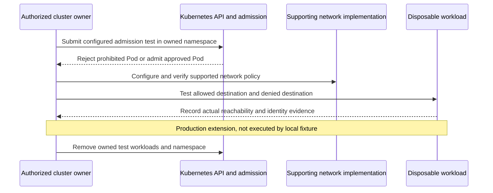

# Ethical Hacker Practical Lab: Review Container Boundaries Before Deployment

Reviewed: 2026-11-06 · Intermediate · 45–60 minutes

## Why this lab changed

Agent executors and build jobs often run untrusted or rapidly changing code. Their container configuration deserves the same review as an externally exposed service. This lab uses negative policy cases rather than host-breakout instructions.

The [Kubernetes Pod Security Standards](https://kubernetes.io/docs/concepts/security/pod-security-standards/) define admission profiles. Our local fixture checks selected Linux Pod fields plus additional organization-policy examples. It is not a full implementation of the Restricted profile or proof of runtime isolation.

## Prerequisites and scope

Python 3.10 or newer and the [workload-hardening source](/labs/examples/workload-hardening.py). No cluster, Docker daemon, privileged process, or host mount is needed. Every unsafe configuration remains an in-memory object and is never submitted to a runtime.



## Exercise 1: run the policy regression suite

```bash
python3 public/labs/examples/workload-hardening.py
```

For a downloaded copy, inspect the source and run `python3 workload-hardening.py`.

Expect four passing tests. The baseline uses a synthetic digest-pinned image, non-root identity, a runtime-default seccomp profile, dropped capabilities, a read-only root filesystem, disabled automatic service-account token mounting, and CPU/memory limits.

The `registry.example` image and repeated `a` digest are fixtures, not a downloadable workload. Replace them with an approved image and its real digest only when building an actual deployment.



## Exercise 2: detect a dangerous change before execution

The negative case adds a host PID namespace, a Docker socket `hostPath`, and a privileged container. The checker returns three violations without launching the container. A separate case enables ambient credentials, a mutable image tag, and a writable root filesystem.

Add regressions for an unsafe init container, an ephemeral debug container, an unconfined seccomp profile, and added capabilities. Include expected failure reasons so a test cannot pass merely because some unrelated validation failed.



## Exercise 3: plan admission and runtime verification separately

| Layer | What to verify in a disposable cluster |
| --- | --- |
| Admission | Server rejects prohibited Pod fields |
| Identity | Workload has only its required service-account permissions |
| Filesystem | Writes are limited to declared scratch volumes |
| Egress | Allowed destinations succeed and denied destinations fail |
| Resource control | CPU, memory, task duration, and process limits behave as intended |

Read [Kubernetes NetworkPolicy guidance](https://kubernetes.io/docs/concepts/services-networking/network-policies/) before adding an egress test. Policies require a supporting network implementation; storing a policy object is not evidence of enforcement. Pod admission and network policy do not provide application-level authorization.



## Expected evidence and acceptance criteria

Save the four passing tests, the selected organization controls, and an explicit list of controls this checker does not evaluate. The baseline must pass; privileged/host access, ambient tokens, mutable images, and an unsafe init container must fail.

Before using a real cluster, record its owner, context, namespace, approved image digest, and cleanup plan. Use server-side validation and admission evidence in that environment. This local fixture neither creates an admission policy nor evaluates all Kubernetes schema, OS, volume, port, and security-context requirements.

## Cleanup and next steps

The exercise writes no files, makes no network calls, and creates no workloads. Delete only your downloaded copy when finished. Continue with [the workload-isolation field note](/blog/Kubernetes-Agent-Isolation-2026), [workload identity](/labs/Zero-Trust-Architecture), and [artifact verification](/labs/Security-Engineering-Fundamentals) to connect configuration review with identity and release evidence.
