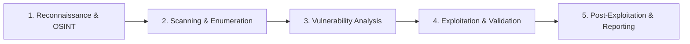

# Ethical Hacking & Offensive Security Practical Lab

> [!IMPORTANT]
> **Production Security Engineering Lab | Tier 4 Applied Defense & Red Teaming Track**
> **Audience:** Cloud Security Engineers, Penetration Testers, Blue/Red Team Analysts
> **Core Tooling:** Kali Linux, Bash Automation, Nmap, ARP Poisoning Defense, Generative AI Security
> **Rules of Engagement:** All offensive methodologies and scanning scripts must only be executed against approved test targets with signed authorization.

---

## 1. 5-Phase Penetration Testing Methodology

Professional penetration testing and offensive security engagements follow a structured 5-phase methodology to uncover and validate security vulnerabilities before malicious actors exploit them.

### Target Architecture & Attack Envelope (Pele Icons)

```architecture
architecture-beta
  service kali(terminal)[Kali Linux Attack Workstation]
  group target(cloud)[Target Cloud Enterprise Environment]
  service waf(firewall)[Cloud Armor / WAF Guard] in target
  service web(server)[Target Web Application] in target
  service api(code)[REST API Endpoint] in target
  service db(database)[Target Customer Database] in target

  kali:R -- L:waf
  waf:R -- L:web
  web:B -- T:api
  api:R -- L:db
```

### Methodology Workflow



1. **Reconnaissance & OSINT**: Gathering passive and active intelligence about the target domain, DNS infrastructure, employee credentials, and exposed IP ranges without directly triggering alarms.
2. **Scanning & Enumeration**: Actively probing targets with network tools like Nmap to discover open ports, running daemon versions, and live endpoints.
3. **Vulnerability Analysis**: Evaluating discovered software versions and endpoints against vulnerability catalogs (CVE/NVD) and automated scanner outputs.
4. **Exploitation & Validation**: Executing controlled proof-of-concept exploits to verify vulnerability impact while adhering to rules of engagement.
5. **Post-Exploitation & Reporting**: Assessing blast radius, demonstrating privilege escalation vectors, documenting remediation steps, and presenting technical risk reports to leadership.

---

## 2. Setting Up the Kali Linux Security Operating System

Kali Linux is an open-source, Debian-derived Linux distribution developed and maintained by Offensive Security. It comes pre-packaged with over 600 specialized tools for penetration testing, digital forensics, and security auditing.

### Deployment Options

1. **Dedicated Hardware / Dual Boot**: Best for hardware Wi-Fi packet injection and bare-metal GPU password cracking (Hashcat).
2. **Virtual Machine (Recommended for Labs)**: Deploy Kali as a guest VM inside VirtualBox, VMware, or UTM. This provides snapshot capabilities to restore the workstation if compromised during testing.
3. **Containerized Kali (Docker)**: Lightweight CLI instances for automated testing pipelines.

```bash
# Pull and run headless Kali Docker container
docker run -it --net=host kalilinux/kali-rolling /bin/bash
```

---

## 3. Essential Linux Terminal Commands for Security Operations

Familiarity with standard Unix commands is essential for performing reconnaissance and log analysis:

```bash
# Navigation and file manipulation
pwd                                      # Print current working directory
ls -la                                   # List files with permissions and hidden entries
cd /var/log                              # Change directory
mkdir -p ./audit/reports                 # Create nested directory tree
rm -rf ./temp_loot                       # Remove directory and contents safely

# Viewing and processing output
cat /etc/passwd                          # Display entire file contents
head -n 20 access.log                    # View first 20 lines of log
tail -f /var/log/auth.log                # Live stream authentication attempts
grep -i "failed password" /var/log/auth.log # Search case-insensitively for failed logins
cut -d':' -f1 /etc/passwd                # Extract username column (delimiter ':')
tr 'A-Z' 'a-z' < input.txt > lower.txt   # Translate uppercase to lowercase characters

# Package management
sudo apt update && sudo apt upgrade -y   # Update package index and installed tools
sudo apt install -y seclists nmap gobuster # Install security tool packages
```

---

## 4. Bash Automation & Network Sweep Scripting

Automating reconnaissance using Bash shell scripts enables rapid auditing of large subnet ranges.

### The Subnet Ping Sweeper Script

The following script iterates through a `/24` subnet, pinging each host concurrently and printing responsive IP addresses:

```bash
#!/bin/bash
# Subnet Ping Sweeper
# Usage: ./ipsweep.sh 192.168.1

if [ -z "$1" ]; then
  echo "[-] Error: Missing subnet prefix!"
  echo "Usage: $0 <subnet-prefix-e.g.-192.168.1>"
  exit 1
fi

echo "[+] Initiating ICMP ping sweep on subnet $1.0/24..."

for ip in $(seq 1 254); do
  ping -c 1 -W 1 "$1.$ip" 2>/dev/null | grep "64 bytes" | cut -d " " -f 4 | tr -d ":" &
done

wait
echo "[+] Sweep complete."
```

```bash
# Grant execution permission and launch
chmod +x ipsweep.sh
./ipsweep.sh 172.28.0
```

---

## 5. Layer 2 Protocols, MAC Spoofing & ARP Poisoning Defense

### Understanding Layer 2 Addressing

Media Access Control (MAC) addresses are 48-bit hardware identifiers assigned to Network Interface Cards (NICs) at Layer 2 (Data Link Layer).

- **Organizationally Unique Identifier (OUI)**: First 24 bits indicate the hardware vendor (e.g., Apple, Cisco, Intel).
- **Network Interface Controller Specific**: Remaining 24 bits identify the specific card.

### Temporary MAC Spoofing

Auditing access controls (such as 802.1X port security or captive portal bypasses) often involves MAC address cycling:

```bash
# Disable interface
sudo ip link set dev eth0 down

# Assign spoofed MAC address
sudo ip link set dev eth0 address 00:11:22:33:44:55

# Re-enable interface and verify
sudo ip link set dev eth0 up
ip link show eth0
```

### ARP Poisoning & Defense Mechanisms

Address Resolution Protocol (ARP) translates Layer 3 IP addresses into Layer 2 MAC addresses. Because ARP lacks authentication, an attacker can broadcast unsolicited ARP replies to claim another host's IP address (Man-in-the-Middle).

> [!WARNING]
> **Enterprise Defenses Against ARP Spoofing**:
> 1. **Dynamic ARP Inspection (DAI)**: Switches validate ARP packets against a trusted DHCP snooping binding database.
> 2. **Static ARP Entries**: Bind gateway IP addresses permanently to gateway MAC addresses on critical production hosts.
> 3. **802.1X Port Security**: Limit each switch port to a single authorized MAC address.

---

## 6. Target Footprinting & Passive OSINT Reconnaissance

Reconnaissance begins with Open Source Intelligence (OSINT) to map the target organization's external footprint without sending packets directly to their servers:

### Passive OSINT Tools
- **WHOIS & RDAP**: Domain registrant information, registrar details, and administrative contacts.
- **DNS Enumeration (`dig`, `dnsrecon`)**: Uncover MX mail servers, TXT SPF records, and subdomains.
- **Certificate Transparency Logs (`crt.sh`)**: Query public SSL/TLS certificate transparency ledgers to discover hidden dev and staging subdomains.
- **Shodan & Censys**: Search engines that index Internet-connected devices, banners, and open ports.

```bash
# Query Certificate Transparency logs for subdomains
curl -s "https://crt.sh/?q=%.example.com&output=json" | jq -r '.[].name_value' | sort -u
```

---

## 7. Active Nmap Scanning & Service Fingerprinting in Kali

Once the perimeter scope is authorized, security engineers utilize Nmap to fingerprint daemons and operating systems:

```bash
# Fast SYN scan across top 100 ports with version detection
sudo nmap -sS -sV -T4 --top-ports 100 127.0.0.1
```

```text
PORT     STATE SERVICE VERSION
21/tcp   open  ftp     vsftpd 3.0.3
80/tcp   open  http    nginx 1.27.4
2222/tcp open  ssh     OpenSSH 9.9
3306/tcp open  mysql   MariaDB 11.7.2
```

---

## 8. Generative AI in Offensive & Defensive Cybersecurity

Large Language Models (LLMs) are transforming cybersecurity operations across both red team and blue team workflows:

- **Red Team Acceleration**: Rapid script synthesis, payload fuzzing, and realistic phishing simulation scenarios.
- **Blue Team Augmentation**: Automated log correlation, SIEM alert triage, and incident response playbooks.
- **Adversarial Risks**: Dual-use models exploited for malware polymorphism and automated social engineering.

> [!NOTE]
> **Defensive Engineering Rule**: Never paste sensitive production logs containing API keys, passwords, or customer PII into public AI chat interfaces. Use on-premises models or zero-data-retention enterprise API endpoints.

---

## 9. AI-Assisted Security Operations, Log Analysis & Threat Modeling Prompts

To extract high-quality, actionable security analysis from AI models, apply structured prompt engineering techniques based on **Specificity, Clarity, and Context**:

### Prompt 1: Secure Configuration Audit
```text
Role: Principal Infrastructure Security Engineer
Task: Conduct a configuration audit for an enterprise Nginx reverse proxy.
Context: The proxy fronts internal microservices in an AWS private subnet.
Requirement: Identify default insecure headers, weak SSL ciphers, and missing rate limits. Provide a hardened nginx.conf snippet conforming to CIS Benchmarks.
```

### Prompt 2: Firewall & IDS Log Triage
```text
Role: Senior SOC Analyst
Task: Analyze the following 20 lines of Suricata alert logs.
Context: Web application DMZ receiving sudden bursts of HTTP POST requests.
Requirement: Correlate source IPs, identify potential SQL injection or directory traversal payloads, and suggest immediate IP block rules for AWS WAF.
```

### Prompt 3: Phishing Simulation & Training Curriculum
```text
Role: Security Awareness & Culture Lead
Task: Design a corporate phishing awareness training module for finance team members.
Context: Financial employees frequently receive invoices from third-party vendors.
Requirement: Provide 3 realistic spear-phishing scenario examples, key red flags to look for, and the internal protocol for reporting suspicious emails without shaming employees.
```

---

## 10. Secure Code Review, Token Authentication & Mobile Hardening

### Auditing Source Code for Injection Flaws

```java
// VULNERABLE CODE (SQL Injection Risk):
String username = request.getParameter("username");
String password = request.getParameter("password");
String query = "SELECT * FROM users WHERE username='" + username + "' AND password='" + password + "'";
```

### Hardened Implementation (Parameterized Prepared Statement)

```java
// HARDENED CODE (Parameterized Query):
String sql = "SELECT id, username, role FROM users WHERE username = ? AND password_hash = ?";
PreparedStatement statement = connection.prepareStatement(sql);
statement.setString(1, username);
statement.setString(2, hashPassword(password));
ResultSet resultSet = statement.executeQuery();
```

### Application Security Checklist

1. **Parameterize Database Queries**: Never concatenate user input into SQL, LDAP, or shell commands.
2. **Cryptographic Salting & Hashing**: Use Argon2id or bcrypt with high work factors for passwords; never use MD5 or SHA-1.
3. **Stateless JWT Hardening**: Validate signature algorithms (`alg: RS256` or `ES256`), reject `alg: none`, and verify expiration (`exp`) timestamps.
4. **Content Security Policy (CSP)**: Enforce strict CSP headers (`default-src 'self'`) to eliminate Cross-Site Scripting (XSS).
