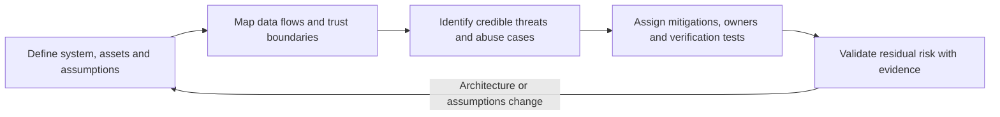
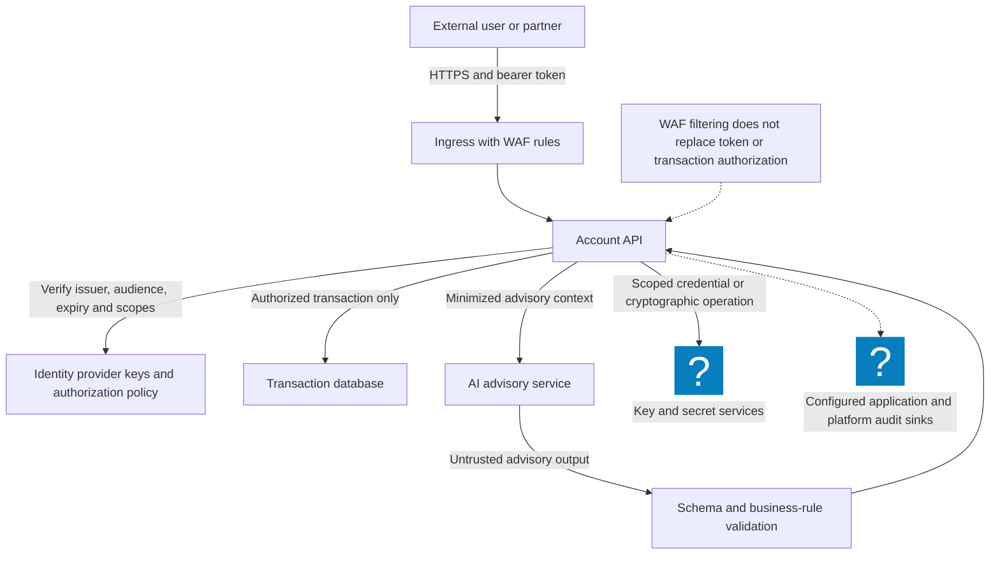
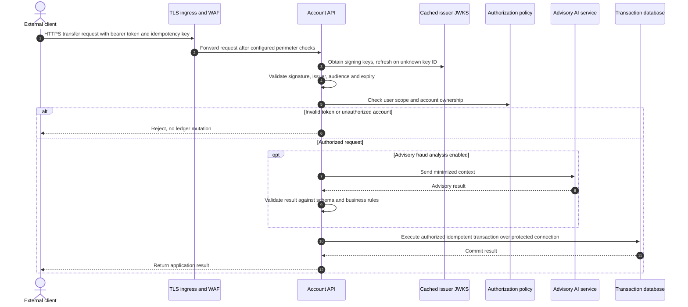
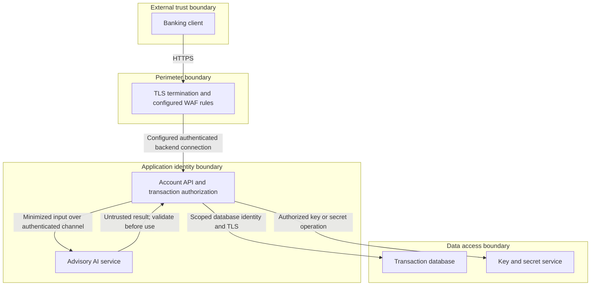

# Threat Modeling: Turn Agent and RAG Boundaries into Regression Tests

Reviewed: 2026-11-06 · Intermediate · 60 minutes

## Why this lab changed

Agent applications connect data retrieval, model context, caches, tools, and delegated identities. A useful threat model connects each crossing to an owner and a test. The [OWASP threat-modeling guidance](https://cheatsheetseries.owasp.org/cheatsheets/Threat_Modeling_Cheat_Sheet.html) provides a structured starting point; the exercises below are original local examples.

OWASP published [GenAI Data Security Best Practices v2, Part 1](https://genai.owasp.org/resource/genai-data-security-best-practices-v2-part1/) on November 3, 2026. Its data-security program framing is a useful prompt to include lifecycle and ownership questions alongside tool execution.

## Prerequisites and scope

Python 3.10 or newer and the [threat-regression exercise](/labs/examples/threat-regression.py). All documents are synthetic in-memory fixtures. No model, embedding service, vector database, or external account is used.

You will map three failures: cross-tenant retrieval, a cache entry shared across callers, and a deleted source that remains retrievable. This does not constitute an automated assessment of a real RAG product.

## Exercise 1: map the system before scoring it



Create a table with assets, entry points, principals, data classifications, trust boundaries, and assumptions. Include retrieved documents, tool output, conversation memory, build artifacts, and cached responses when they exist in your system.

Use this account-service reference to distinguish routing from authorization:



For each flow, ask who establishes identity, who checks object permissions, and which component can deny the operation. A WAF or a private network does not supply document-level access control.

## Exercise 2: execute the boundary checks

```bash
python3 public/labs/examples/threat-regression.py
```

Alternatively, download and inspect [the script](/labs/examples/threat-regression.py), then run `python3 threat-regression.py`.

Expect four passing tests and a printed threat register. Tenant and document ACL filters run before the caller receives content. The cache key includes tenant, identity, policy revision, and query. The deletion test removes the source and checks a changed policy revision, rather than pretending that deleting source text automatically invalidates every cache.

## Exercise 3: prove the tests can detect a regression

In your own copy, remove the identity check from `retrieve`. The cross-tenant/ACL test must fail. Restore it, then remove identity from `cache_key`; the cache-isolation test must fail. Keep a before-and-after test log.

The production token-validation sequence is a separate boundary:



Do not treat decoding a JWT or drawing a JWT-validation box as proof of signature, issuer, audience, expiry, or object permission enforcement.

## Expected evidence and acceptance criteria

| Threat | Owner | Required evidence |
| --- | --- | --- |
| Tenant B document reaches tenant A | Search team | Negative retrieval test |
| Cached answer reused by another identity | Platform team | Cache-key isolation test |
| Deleted or revoked source remains available | Data team | Removal test and invalidation design |

Each record needs a scenario, preconditions, business impact, mitigation, owner, and verification method. STRIDE can help enumerate categories. Avoid multiplying arbitrary DREAD numbers into a supposedly precise risk score. Keep likelihood assumptions, exposure, impact, and confidence visible.

## Review the deployment and clean up



Use this deployment reference to identify where identity, policy, audit, storage, and cache controls actually run. Add prompt-injection and tool-output scenarios, then use the [agent-boundary lab](/labs/Agentic-Cloud-Security) to test action authorization separately.

The script creates no files and makes no network calls. A production extension must test the actual retrieval engine, ACL update path, cache invalidation, tenant deletion, and backup retention. Link each unresolved assumption to an owner rather than marking it complete because this fixture passes.
