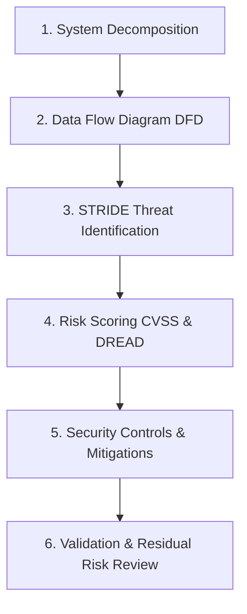
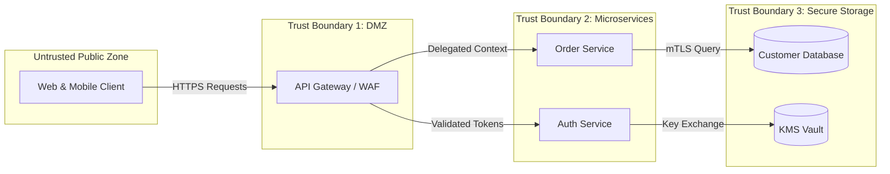

# Threat Modeling Practical Guide: STRIDE, DFDs & Risk Scoring

> [!IMPORTANT]
> **Production Security Engineering Lab | Tier 2 Architecture & Verification Track**
> **Audience:** Security Architects, Cloud Engineers, DevSecOps Leads, AppSec Practitioners
> **Core Methodologies:** Threat Modeling Manifesto, STRIDE, PASTA, DREAD, MITRE ATT&CK & D3FEND
> **Guiding Principle:** Identifying and mitigating design flaws during architecture design is orders of magnitude less costly than remediating post-deployment breaches.

---

## 1. Threat Modeling Philosophy & Objectives

Threat modeling is a structured, engineering-driven approach used to identify, assess, and address potential security threats to systems, applications, and cloud infrastructures. As defined by Adam Shostack (author of *Threat Modeling: Designing for Security*):

> *"Threat modeling is the use of abstractions to aid in thinking about risks."*

Rather than treating security as an afterthought or a reactive bug-hunting process, threat modeling builds security directly into the software architecture from inception.

### Core Objectives of Threat Modeling

1. **Identify Valuable Assets**: Determine what mission-critical data, intellectual property, credentials, APIs, and infrastructure components need protection.
2. **Deconstruct the Attack Surface**: Map external actors, entry points, communication channels, and internal trust boundaries.
3. **Uncover Architectural Flaws**: Distinguish fundamental design flaws (which code reviews often miss) from localized implementation bugs.
4. **Prescribe Deterministic Mitigations**: Establish targeted cryptographic, architectural, and policy controls to reduce risk to acceptable tolerance levels.
5. **Continuous Verification**: Maintain the threat model as living documentation across iterative release cycles.

---

## 2. The Four-Question Framework & Core Principles

According to the [Threat Modeling Manifesto](https://www.threatmodelingmanifesto.org), every successful threat modeling engagement is anchored around four fundamental inquiries:

1. **What are we working on?** (System Decomposition & Data Flow Diagrams)
2. **What can go wrong?** (Threat Enumeration & Attack Trees)
3. **What are we going to do about it?** (Mitigations, Controls & Remediation)
4. **Did we do a good enough job?** (Retrospective, Verification & Residual Risk Acceptance)

> [!NOTE]
> **Threat Modeling is a Team Discipline**: Effective threat modeling is never a solo exercise conducted in isolation by a security engineer. It requires collaboration between Software Engineers, Cloud Architects, Site Reliability Engineers, and GRC leads.

---

## 3. Threat Modeling Diagrams & Data Flow Architecture

### System Trust Boundary Topology (Pele Architecture)

The Pele architecture diagram below illustrates a microservice system partitioned across three distinct trust boundaries:

```architecture
architecture-beta
  group client(internet)[Untrusted External Clients]
  service web(user)[Web Browser Client] in client
  service mobile(user)[Mobile App Client] in client

  group dmz(cloud)[Trust Boundary 1: Perimeter DMZ]
  service waf(firewall)[Cloud WAF & Reverse Proxy] in dmz

  group apps(server)[Trust Boundary 2: Microservices]
  service api(server)[API Gateway Service] in apps
  service auth(lock)[Authentication Service] in apps

  group storage(database)[Trust Boundary 3: Confidential Data]
  service db(database)[Customer Records Database] in storage
  service kms(key)[KMS Key & Secret Vault] in storage

  web:R -- L:waf
  mobile:R -- L:waf
  waf:R -- L:api
  api:B -- T:auth
  auth:R -- L:kms
  api:R -- L:db
```

### Threat Modeling Lifecycle Workflow



### Data Flow Diagram (DFD) with Trust Boundaries

Data Flow Diagrams trace information movements between processes, data stores, and external entities across explicit trust perimeters:



---

## 4. Threat Modeling Methodologies (PASTA vs. Microsoft 5-Step)

Organizations adopt structured methodologies to systematically uncover design weaknesses:

### Microsoft 5-Step Threat Modeling
1. **Define Security Requirements**: Establish security SLAs, confidentiality tiers, and compliance baselines.
2. **Diagram the Application**: Create Level-0, Level-1, and Level-2 Data Flow Diagrams.
3. **Identify Threats**: Apply the STRIDE mnemonic to every element in the DFD.
4. **Mitigate Threats**: Select architectural controls (e.g., mTLS, token binding, WAF inspection).
5. **Validate Mitigations**: Verify that implemented controls neutralize identified threat paths.

### PASTA (Process for Attack Simulation and Threat Analysis)
A risk-centric 7-step framework aligning business risk with technical threat vectors:
1. **Define Objectives**: Align business impact with financial risk tolerances.
2. **Define Technical Scope**: Identify dependencies, third-party APIs, and infrastructure envelopes.
3. **Decompose Application**: Map components, trust boundaries, and communication paths.
4. **Analyze Threats**: Model threat actor motivations using cyber threat intelligence.
5. **Analyze Vulnerabilities**: Correlate known CVEs and architecture weaknesses.
6. **Attack Modeling (Attack Trees)**: Map probabilistic paths to achieve attacker objectives.
7. **Risk & Impact Analysis**: Quantify residual business risk and prioritize mitigation backlog.

| Four Questions | PASTA 7-Step | Microsoft 5-Step |
|---|---|---|
| **What are we working on?** | 1. Define objectives<br>2. Define technical scope<br>3. Application decomposition (DFD) | 1. Define security requirements<br>2. Diagram application (DFD) |
| **What can go wrong?** | 4. Threat analysis<br>5. Vulnerability analysis<br>6. Attack modeling (Attack Trees) | 3. Identify threats (STRIDE) |
| **What are we going to do?** | 7. Risk & impact analysis | 4. Mitigate threats |
| **Did we do a good enough job?** | Retrospective & audit verification | 5. Validate threats are mitigated |

---

## 5. STRIDE Threat Classification Taxonomy

Developed at Microsoft, STRIDE categorizes threats into six core disciplines:

| Threat | Security Property Violated | Definition | Example Attack Vector | Primary Mitigation Controls |
|---|---|---|---|---|
| **S**poofing | **A**uthentication | Impersonating a user, service, or system entity | Forging JWT bearer tokens or IP spoofing | Mutual TLS (mTLS), FIDO2/WebAuthn, SPIFFE workload identities |
| **T**ampering | **I**ntegrity | Modifying data in transit or at rest without authorization | Parameter tampering in transit, modifying database records | HMAC signatures, TLS 1.3, immutability ledgers (WORM) |
| **R**epudiation | **N**on-Repudiation | Denying an action performed due to missing audit trails | Disputing a high-value money transfer | Cryptographically signed audit logs, append-only centralized SIEM |
| **I**nformation Disclosure | **C**onfidentiality | Exposing confidential data to unauthorized entities | S3 bucket misconfiguration, API response PII leakage | AES-256-GCM envelope encryption, field-level tokenization, strict RBAC |
| **D**enial of Service | **A**vailability | Exhausting computing resources to degrade availability | SYN flood attacks, algorithmic complexity attacks (ReDoS) | Anycast CDN, Cloud Armor/AWS Shield, rate-limiting tokens |
| **E**levation of Privilege | **A**uthorization | Gaining unauthorized access to higher permissions | IAM role assumption exploits, privilege escalation | Principle of Least Privilege (PoLP), AWS SCPs, OPA Rego guardrails |

---

## 6. Risk Scoring Models: DREAD & CVSS v3.1

### The DREAD Risk Assessment Model

DREAD calculates a numeric severity score (from 0 to 10) across five dimensions:

$$\text{Risk Score} = \frac{D + R + E + A + D}{5}$$

- **Damage Potential**: How severe is the damage if the vulnerability is exploited? (0 = None, 10 = Complete system takeover)
- **Reproducibility**: How easy is it for an attacker to reproduce the exploit? (0 = Nearly impossible, 10 = Automated script)
- **Exploitability**: What skill level or tools are required? (0 = Advanced nation-state exploit, 10 = Simple HTTP request)
- **Affected Users**: What percentage of users are impacted? (0 = None, 10 = 100% of customer base)
- **Discoverability**: How easy is it to find the flaw? (0 = Extremely obscure, 10 = Publicly visible in HTTP headers)

> [!TIP]
> Modern teams often use **DREAD-D** (omitting the Discoverability factor) to avoid the pitfall of "security through obscurity."

---

## 7. Vulnerability Catalogs & Compliance Alignment

### Global Threat & Vulnerability Databases
- **[MITRE ATT&CK](https://attack.mitre.org)**: The industry benchmark taxonomy of 14 adversarial tactics and hundreds of real-world techniques.
- **[MITRE D3FEND](https://d3fend.mitre.org)**: A knowledge graph of cybersecurity defensive techniques and countermeasures that directly maps to ATT&CK techniques.
- **[NIST National Vulnerability Database (NVD)](https://nvd.nist.gov)**: The US government repository of standards-based vulnerability management data.
- **[OWASP Top 10 Application Security Risks](https://owasp.org/www-project-top-ten/)**: The gold standard awareness document for web application vulnerabilities.

### Regulatory Alignment
- **NIST SP 800-53 Rev 5**: System and Communications Protection (SC) and Access Control (AC) families.
- **SOC 2 Type II**: Trust Services Criteria for Security, Availability, and Confidentiality.
- **PCI-DSS v4.0**: Requirement 6 (Develop and Maintain Secure Systems and Software).
- **ISO/IEC 27001:2022**: Control 8.25 (Secure Development Lifecycle).

---

## 8. Threat Modeling Automation Tools & Diagrams-as-Code

Modern DevSecOps pipelines leverage code-driven threat modeling tools:

- **[OWASP Threat Dragon](https://github.com/OWASP/threat-dragon)**: Open-source modeling tool supporting STRIDE and rule-based risk engines.
- **[OWASP pytm](https://owasp.org/www-project-pytm/)**: Pythonic threat modeling framework that compiles code into Data Flow Diagrams and automated STRIDE findings.
- **[StrideGPT](https://github.com/mrwadams/stride-gpt)**: AI-driven threat modeling pipeline that ingests architecture diagrams and outputs MITRE ATT&CK mitigations.
- **[Elevation of Privilege (EoP)](https://shostack.org/games/elevation-of-privilege)**: Serious tabletop card game designed to introduce developers to STRIDE threat modeling in sprint planning sessions.
