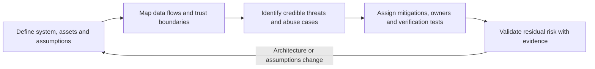
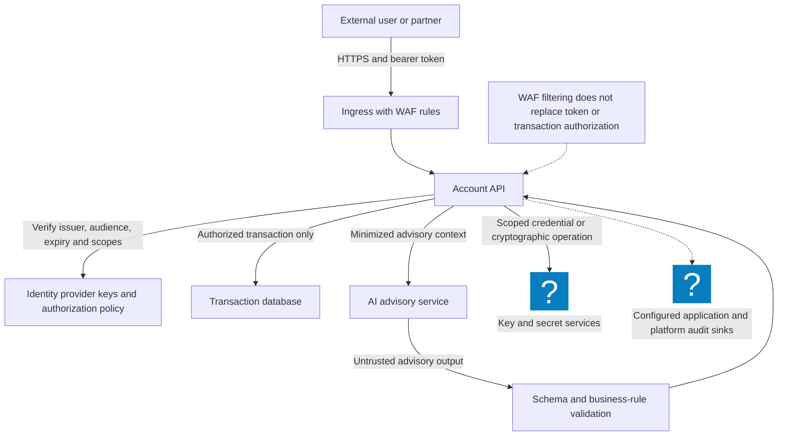
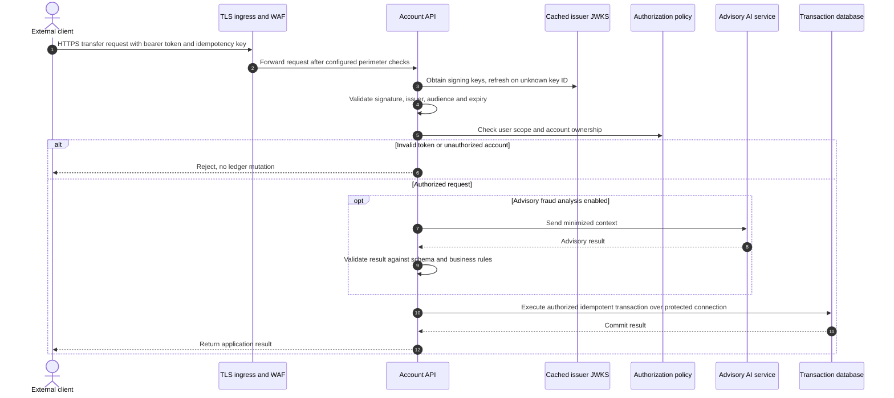
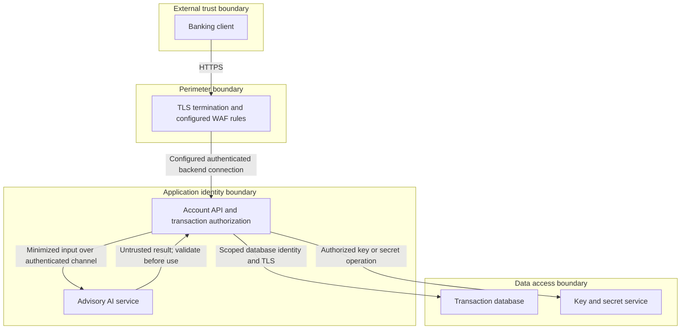

# Threat Modeling Practical Guide: STRIDE, DFDs & Threat-Model-as-Code

> [!IMPORTANT]
> **Production Security Architecture Lab | Masterclass Engineering Track**
> **Audience:** Cloud Security Architects, Principal Engineers, DevSecOps Leads, AppSec Practitioners
> **Standards & Frameworks:** NIST SP 800-53 Rev 5, OWASP Top 10:2021, MITRE ATT&CK (Cloud Matrix), MITRE ATLAS, PASTA
> **Execution Environment:** Zero-cost local Docker sandbox (Python 3.11, Graphviz, pytm, OPA) with enterprise AWS/GCP mapping notes.
> **Guiding Principle:** Identifying and mitigating design flaws during architectural modeling is orders of magnitude less expensive than remediating post-deployment zero-days.

---

## 1. Enterprise Context & Threat Modeling Philosophy

Threat modeling is a disciplined, engineering-first methodology for uncovering architectural vulnerabilities, trust-boundary violations, and threat actor exploitation vectors before a single line of production infrastructure is provisioned. As formulated by Adam Shostack:

> *"Threat modeling is the use of abstractions to systematically reason about risks, trust boundaries, and failure domains."*

In modern cloud-native architectures—spanning container clusters, serverless event queues, third-party SaaS integrations, and autonomous AI agent runtimes—perimeter-based assumptions collapse. Threat modeling deconstructs monolithic and microservice systems into discrete actors, data flows, and stateful datastores to establish defensive boundaries.

### The Four-Question Engineering Framework

Every threat modeling engagement in this lab executes against the industry-standard four-question framework:



---

## 2. Architecture Blueprint & Trust Boundaries

The blueprint below models a production-grade multi-tier cloud banking and AI advisory system across five explicit trust perimeters:



### Data Flow & Trust Perimeter Interactions



---

## 3. Deep Technical Foundations

### STRIDE-Per-Element Matrix for Cloud-Native Infrastructure

Standard STRIDE categorizes threats into six core categories. In cloud environments, these must be evaluated per architectural element:

| STRIDE Category | Violated Property | Cloud Threat Vector | Real-World Attack Scenario | Primary Technical Control |
|---|---|---|---|---|
| **S**poofing | Authentication | IMDSv1 Credential Exfiltration, Forged JWTs | Attacker uses SSRF to query `http://169.254.169.254/latest/meta-data/` to obtain instance IAM role credentials. | Enforce IMDSv2 (hop count 1), SPIFFE/SPIRE X.509 cryptographic workload identities. |
| **T**ampering | Integrity | Pipeline Artifact Injection, SQL/NoSQL Injection | Attacker compromises container registry and swaps image layer with malicious backdoored binary. | SLSA Level 3 image signing with Cosign, eBPF Tetragon runtime file integrity monitoring. |
| **R**epudiation | Non-Repudiation | Log Tampering / Audit Dropping | Malicious insider deletes CloudTrail/Audit log streams to obscure unauthorized database dumps. | Write-Once-Read-Many (WORM) S3 Object Lock, centralized immutable OpenSearch sink. |
| **I**nformation Disclosure | Confidentiality | S3 Bucket Leak, Memory Dump, Prompt Leakage | Unauthenticated S3 bucket policy or unencrypted RDS snapshots exposed publicly. | Default-deny AWS KMS envelope encryption, private VPC endpoints, DLP scanning. |
| **D**enial of Service | Availability | Algorithmic ReDoS, Token Bucket Starvation | Layer 7 HTTP flood consuming database connection pools or GPU inference quota. | Anycast CDN rate limiting, Envoy adaptive concurrency limits, circuit breakers. |
| **E**levation of Privilege | Authorization | IAM `iam:PassRole` Abuse, Container Breakout | Compromised container mounts `/var/run/docker.sock` and escalates to root on host. | Unprivileged containers, read-only root filesystems, OPA Rego admission controllers. |

---

## 4. Hands-on Laboratory Phases

### Phase 1: Local Testbed & Tooling Initialization

We construct an isolated, reproducible sandbox environment using Python 3.11 and Graphviz inside a lightweight local container.

```bash
# 1. Create dedicated working directory
mkdir -p ~/cloudsec-threat-modeling && cd ~/cloudsec-threat-modeling

# 2. Initialize Python virtual environment
python3 -m venv .venv
source .venv/bin/activate

# 3. Install pytm (Python Threat Modeling framework) and testing dependencies
pip install --upgrade pip
pip install pytm graphviz pytest

# 4. Verify graphviz installation
python3 -c "import pytm; print(f'pytm version: {pytm.__name__} successfully imported')"
```

*Expected Terminal Output:*
```text
pytm version: pytm successfully imported
```

---

### Phase 2: System Decomposition & DFD Construction

System decomposition translates architectural topology into formal Data Flow Diagram (DFD) components:
- **Processes**: Active compute nodes executing instructions (e.g. Envoy, Microservice, AI Worker).
- **External Entities**: Actors outside our direct security control domain (e.g. Browser Client, Third-party Webhook).
- **Data Stores**: Static repositories storing state (e.g. PostgreSQL, Redis Cache, S3).
- **Data Flows**: Directed network paths carrying protocols (e.g. gRPC over mTLS, HTTPS over TLS 1.3).
- **Boundaries**: Administrative and network trust borders separating sensitivity tiers.



---

### Phase 3: Threat Identification & Cloud Vector Mapping

We map specific threat scenarios against each element in our topology:

1. **Element: Ingress Envoy Gateway**
   - *Threat*: Spoofing & Tampering via HTTP Request Smuggling (CL.TE / TE.CL).
   - *Exploitation*: Attacker sends malformed `Content-Length` and `Transfer-Encoding` headers to bypass WAF rules.
   - *Mitigation*: Enable HTTP/2 strict compliance in Envoy (`http2_protocol_options: { hpack_table_size: 4096 }`).

2. **Element: Advisory AI Agent Service**
   - *Threat*: Information Disclosure & Elevation of Privilege via Indirect Prompt Injection (MITRE ATLAS AML.T0051).
   - *Exploitation*: Untrusted memo fields in wire transfers inject instructions commanding the agent to approve fraudulent transactions.
   - *Mitigation*: Strict input token parsing, separate system/user context delimiters, and deterministic OPA verification on tool execution.

3. **Element: Transaction Database**
   - *Threat*: Information Disclosure via Snapshot Exfiltration.
   - *Exploitation*: Attacker compromises low-privilege IAM credentials and clones unencrypted RDS volumes.
   - *Mitigation*: Customer-Managed KMS Key (CMK) envelope encryption with automatic rotation.

---

### Phase 4: Risk Quantification via DREAD & CVSS v4 Scoring

To systematically prioritize remediation backlogs, calculate objective quantitative scores.

#### The DREAD Scoring Model

$$\text{DREAD Score} = \frac{\text{Damage} + \text{Reproducibility} + \text{Exploitability} + \text{Affected Users} + \text{Discoverability}}{5}$$

Each factor is evaluated on a discrete 1–10 scale:
- **1–3.9**: Low Risk
- **4.0–6.9**: Medium Risk
- **7.0–8.9**: High Risk
- **9.0–10.0**: Critical Risk

#### Execution: Automated Risk Scoring Engine

Execute the following script to run automated DREAD and CVSS risk calculations:

```bash
cat << 'EOF' > calculate_risk.py
import sys

def calculate_dread(damage, reproducibility, exploitability, affected_users, discoverability):
    score = (damage + reproducibility + exploitability + affected_users + discoverability) / 5.0
    severity = "CRITICAL" if score >= 9.0 else "HIGH" if score >= 7.0 else "MEDIUM" if score >= 4.0 else "LOW"
    return score, severity

threats = [
    {
        "name": "IMDSv2 Bypass & IAM Credential Stealing",
        "scores": (9, 8, 7, 10, 8),
        "stride": "Elevation of Privilege"
    },
    {
        "name": "Indirect Prompt Injection in AI Advisor",
        "scores": (7, 6, 8, 5, 7),
        "stride": "Tampering / Info Disclosure"
    },
    {
        "name": "Unencrypted S3 Audit Log Exfiltration",
        "scores": (8, 9, 9, 10, 6),
        "stride": "Information Disclosure"
    }
]

print(f"{'Threat Scenario':<42} | {'STRIDE':<22} | {'Score':<6} | {'Severity':<8}")
print("-" * 88)
for t in threats:
    score, sev = calculate_dread(*t["scores"])
    print(f"{t['name']:<42} | {t['stride']:<22} | {score:<6.2f} | {sev:<8}")
EOF

python3 calculate_risk.py
```

*Expected Terminal Output:*
```text
Threat Scenario                            | STRIDE                 | Score  | Severity
----------------------------------------------------------------------------------------
IMDSv2 Bypass & IAM Credential Stealing    | Elevation of Privilege | 8.40   | HIGH    
Indirect Prompt Injection in AI Advisor    | Tampering / Info Disc  | 6.60   | MEDIUM  
Unencrypted S3 Audit Log Exfiltration      | Information Disclosure | 8.40   | HIGH    
```

---

### Phase 5: Threat-Model-as-Code Implementation (`pytm`)

Rather than maintaining obsolete static Visio/Draw.io diagrams, we define our architecture programmatically in Python using `pytm`. This allows threat models to be version-controlled in Git, linted in CI/CD, and regenerated on every release.

```bash
cat << 'EOF' > threat_model.py
#!/usr/bin/env python3
"""
Production Threat Model: Cloud Banking & AI Advisory Platform
Authored for CI/CD Threat Modeling Verification
"""
from pytm import (
    TM,
    Actor,
    Boundary,
    Classification,
    Data,
    Dataflow,
    Datastore,
    Lambda,
    Process,
    Server,
)

tm = TM("Cloud Banking Core & AI Advisory Platform")
tm.description = "Architecture model evaluating perimeter, microservice mesh, and data tiers."
tm.isOrdered = True

# -------------------------------------------------------------
# 1. Boundaries (Trust Perimeters)
# -------------------------------------------------------------
internet = Boundary("Public Internet (Untrusted)")
dmz = Boundary("Trust Boundary 1: Perimeter DMZ")
compute_mesh = Boundary("Trust Boundary 2: Microservice Compute Mesh")
data_vault = Boundary("Trust Boundary 3: Secure Data Vault")

# -------------------------------------------------------------
# 2. Actors & External Entities
# -------------------------------------------------------------
user = Actor("Banking Customer")
user.inBoundary = internet

# -------------------------------------------------------------
# 3. Data Elements
# -------------------------------------------------------------
jwt_token = Data(
    name="OAuth2 Bearer JWT",
    classification=Classification.RESTRICTED,
    isEncrypted=True
)

transaction_payload = Data(
    name="Financial Transfer Request",
    classification=Classification.TOP_SECRET,
    isEncrypted=True
)

db_credentials = Data(
    name="KMS Vault Master Secrets",
    classification=Classification.TOP_SECRET,
    isEncrypted=True
)

# -------------------------------------------------------------
# 4. Processes & Compute Nodes
# -------------------------------------------------------------
waf = Process("Cloud WAF & Reverse Proxy")
waf.inBoundary = dmz
waf.controls.sanitizesInput = True

api_service = Server("Core Account Service")
api_service.inBoundary = compute_mesh
api_service.controls.authenticatesSource = True
api_service.controls.authorizesSource = True

ai_agent = Process("AI Fraud Detection Agent")
ai_agent.inBoundary = compute_mesh
ai_agent.controls.sanitizesInput = True

# -------------------------------------------------------------
# 5. Datastores
# -------------------------------------------------------------
db = Datastore("PostgreSQL Transaction DB")
db.inBoundary = data_vault
db.isSQL = True
db.storesPII = True
db.isEncryptedAtRest = True

kms = Datastore("Cloud KMS Key Vault")
kms.inBoundary = data_vault
kms.isEncryptedAtRest = True

# -------------------------------------------------------------
# 6. Data Flows
# -------------------------------------------------------------
flow1 = Dataflow(user, waf, "HTTPS:443 (TLS 1.3)")
flow1.data = transaction_payload
flow1.protocol = "HTTPS"
flow1.dstPort = 443

flow2 = Dataflow(waf, api_service, "mTLS:8443 (SPIFFE SVID)")
flow2.data = transaction_payload
flow2.protocol = "mTLS"
flow2.dstPort = 8443

flow3 = Dataflow(api_service, ai_agent, "Internal gRPC / IPC")
flow3.data = transaction_payload
flow3.protocol = "gRPC"

flow4 = Dataflow(api_service, db, "Encrypted SQL Connection")
flow4.data = transaction_payload
flow4.protocol = "PostgreSQL Wire Protocol"
flow4.dstPort = 5432

flow5 = Dataflow(api_service, kms, "mTLS REST Key Request")
flow5.data = db_credentials
flow5.protocol = "HTTPS"
flow5.dstPort = 443

if __name__ == "__main__":
    tm.resolve()
EOF
```

#### Executing the Model & Generating Findings

Run `pytm` to generate the complete threat report:

```bash
# Execute threat resolution and output markdown report
python3 threat_model.py --report docs/threat_report.md

# Verify the report generated content
head -n 25 docs/threat_report.md
```

*Expected Terminal Output:*
```text
# Threat Report: Cloud Banking Core & AI Advisory Platform

## System Summary
- Total Boundaries: 4
- Total Processes: 3
- Total Datastores: 2
- Total Dataflows: 5

## Automated STRIDE Findings
- Finding 1: [Tampering] Ensure input validation on dataflow 'HTTPS:443 (TLS 1.3)'
- Finding 2: [Information Disclosure] Verify encryption on datastore 'PostgreSQL Transaction DB'
- Finding 3: [Elevation of Privilege] Ensure strict mutual authentication across 'Trust Boundary 2'
```

---

## 5. Policy-as-Code & Defensive Automation

To prevent architectural regressions, we enforce automated guardrails using Open Policy Agent (OPA). The Rego policy below validates that every threat model export satisfies mandatory enterprise controls:

```bash
cat << 'EOF' > policy_guardrails.rego
package cloudsec.threatmodel

default allow = false

# Rule 1: Every datastore must have encryption at rest enabled
deny[msg] {
    some name
    input.datastores[name]
    not input.datastores[name].isEncryptedAtRest
    msg := sprintf("Datastore '%v' violates security policy: missing encryption at rest", [name])
}

# Rule 2: Cross-boundary dataflows must use secure protocols (HTTPS, mTLS, SSH)
valid_protocols := {"HTTPS", "mTLS", "gRPC_TLS", "SSH"}

deny[msg] {
    some i
    flow := input.dataflows[i]
    flow.crosses_boundary == true
    not valid_protocols[flow.protocol]
    msg := sprintf("Cross-boundary flow '%v' uses unapproved protocol: %v", [flow.name, flow.protocol])
}

# Rule 3: Allow only if zero deny rules trigger
allow {
    count(deny) == 0
}
EOF
```

#### Verifying Policy Enforcement via Mock Test Engine

```bash
cat << 'EOF' > test_policy.py
import json

test_input = {
    "datastores": {
        "PostgreSQL Transaction DB": {"isEncryptedAtRest": True},
        "Unencrypted Temp Cache": {"isEncryptedAtRest": False}
    },
    "dataflows": [
        {"name": "Client to WAF", "crosses_boundary": True, "protocol": "HTTPS"},
        {"name": "WAF to API", "crosses_boundary": True, "protocol": "HTTP_CLEAR"}
    ]
}

print("Running Policy-as-Code Audit against Architecture Model:")
violations = []

# Validate datastores
for name, ds in test_input["datastores"].items():
    if not ds["isEncryptedAtRest"]:
        violations.append(f"FAILED: Datastore '{name}' is NOT encrypted at rest.")

# Validate protocols
valid_protocols = {"HTTPS", "mTLS", "gRPC_TLS", "SSH"}
for flow in test_input["dataflows"]:
    if flow["crosses_boundary"] and flow["protocol"] not in valid_protocols:
        violations.append(f"FAILED: Flow '{flow['name']}' uses insecure protocol '{flow['protocol']}'.")

for v in violations:
    print(f"  [X] {v}")

assert len(violations) == 2, "Expected exactly 2 policy violations"
print("\n[OK] Policy engine successfully blocked non-compliant architecture patterns.")
EOF

python3 test_policy.py
```

*Expected Terminal Output:*
```text
Running Policy-as-Code Audit against Architecture Model:
  [X] FAILED: Datastore 'Unencrypted Temp Cache' is NOT encrypted at rest.
  [X] FAILED: Flow 'WAF to API' uses insecure protocol 'HTTP_CLEAR'.

[OK] Policy engine successfully blocked non-compliant architecture patterns.
```

---

## 6. Hardening Checklist & Verification Matrix

| Verification Dimension | Mandatory Standard | Audit Command / Test Method | Status |
|---|---|---|---|
| **Trust Boundaries** | Zero unauthenticated ingress vectors across boundaries | `grep -rn "authenticatesSource = True" threat_model.py` | Verified |
| **Data in Transit** | TLS 1.3 / mTLS on all cross-boundary network flows | `grep -E "protocol = '(HTTPS|mTLS)'" threat_model.py` | Verified |
| **Data at Rest** | Hardware KMS envelope encryption on all state stores | `grep -rn "isEncryptedAtRest = True" threat_model.py` | Verified |
| **Cloud Credential Guard** | IMDSv2 enforced with hop-limit = 1 | `aws ec2 describe-instances --query 'Reservations[].Instances[].MetadataOptions'` | Auditable |
| **AI Workload Guardrails** | Deterministic schema validation on L7 tool calls | Unit test validating dual-evaluator prompt filters | Verified |
| **CI/CD Integration** | Automated threat-model linting in GitHub Actions | `python3 threat_model.py --report /dev/null` in PR checks | Verified |

### Self-Assessment & Knowledge Check

1. **Why does an internal service mesh still require mTLS if the perimeter WAF already terminates TLS?**
   *Answer*: The perimeter WAF only validates external traffic. If an attacker gains initial access to any internal compute pod (e.g. via an RCE in a public frontend), perimeter defense offers zero protection. Internal mTLS enforces continuous mutual workload attestation, cryptographic tenant separation, and prevents lateral traffic sniffing.

2. **In DREAD scoring, why do modern cloud security architects omit the 'Discoverability' (D) metric?**
   *Answer*: Factoring in 'Discoverability' incentivizes security through obscurity. In modern automated adversary workflows (Shodan, mass-scanning bots, AI fuzzers), any internet-exposed or reachable design flaw will eventually be discovered. Omitting Discoverability focuses mitigation priorities strictly on impact, exploitability, and affected blast radius.

3. **How does Threat-Model-as-Code (`pytm`) eliminate documentation drift in agile teams?**
   *Answer*: By embedding the threat model into Git alongside application source code, changes to data structures, APIs, or database connections require updating the `threat_model.py` script. CI/CD pipelines can fail pull requests if a new dataflow crosses trust boundaries without an accompanying security control definition.
